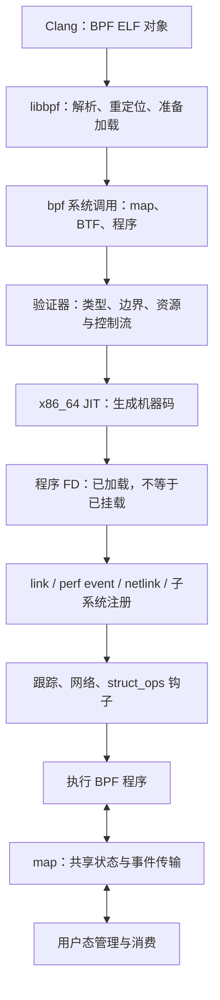

# 第 13 章 BPF 子系统

本章以 Linux v6.18.60、x86_64 为基准，分析 BPF 如何在不修改内核主路径的前提下，为跟踪、网络处理和子系统策略提供受约束的可编程接口。阅读主线是：**用户态准备对象 → 系统调用加载 → 验证器检查 → JIT 编译 → 挂载到钩子 → 事件驱动执行 → 引用释放**。

本章默认讨论扩展 BPF（extended BPF，eBPF），简称 BPF；经典 BPF（classic BPF，cBPF）只用于说明接口边界。BPF 并不是一个独立调度的内核进程：程序通常由挂载点同步调用，其上下文、返回值与可用接口由程序类型及挂载方式共同决定。

*图 13-0：BPF 从加载到执行的主线；不同挂载点不一定使用同一种管理接口*

## 阅读建议

- 13.1 建立程序、map、BTF 和 link 四类对象的关系；13.2 按 `bpf()` 系统调用分析权限与生命周期。
- 13.3、13.4、13.5 分别回答“为什么允许执行”“状态放在哪里”“最终怎样执行”。
- 13.6 区分对象自身的类型信息、内核 BTF 与 CO-RE；13.7 讨论挂载点与引用管理，衔接 [3.11 sched_ext](../03-scheduler/11-sched-ext.md)。
- 13.8、13.9 用跟踪与网络两条路径说明：相同的 BPF 指令，在不同钩子上有不同语义。
- 13.10 汇总观测入口，并给出不依赖内核 BTF、不挂载到生产网络的最小加载实验。
- 理解引用计数、RCU 和执行上下文前，可先阅读第 7 章；跟踪背景见第 3、5 章。第 11 章网络栈尚在规划中，本章只展开 BPF 接入点，不替代完整协议栈分析。

## 本章配置

取值核对自 [`linux/.config`](../../linux/.config)。运行实验前还必须检查虚拟机实际启动的内核；仓库配置不代表宿主机或虚拟机发行版内核的能力。

| 配置 | 仓库取值 | 含义与限制 |
|---|---|---|
| `CONFIG_BPF` / `CONFIG_BPF_SYSCALL` | y / y | BPF 基础设施与用户态加载接口 |
| `CONFIG_BPF_JIT` / `CONFIG_HAVE_EBPF_JIT` | y / y | 启用架构 JIT，x86_64 实现在本章分析范围内 |
| `CONFIG_BPF_JIT_ALWAYS_ON` / `CONFIG_BPF_JIT_DEFAULT_ON` | y / y | 必须使用 JIT；不能把解释器当作加载失败时的可用后备 |
| `CONFIG_BPF_UNPRIV_DEFAULT_OFF` | y | 非特权 BPF 默认关闭；运行时仍须检查 sysctl |
| `CONFIG_BPF_EVENTS` / `CONFIG_PERF_EVENTS` | y / y | 跟踪程序与 perf 挂载基础设施 |
| `CONFIG_KPROBES` / `CONFIG_KPROBE_EVENTS` / `CONFIG_UPROBE_EVENTS` | y / y / y | 内核与用户态动态探针支持 |
| `CONFIG_FTRACE` / `CONFIG_DYNAMIC_FTRACE_WITH_DIRECT_CALLS` | y / y | 函数跟踪与直接调用支持，不单独保证 fentry 可用 |
| `CONFIG_DEBUG_INFO_BTF` | 未启用，配置文件无该项 | 没有内置内核 BTF；`CONFIG_PAHOLE_VERSION=0`，不能把 DWARF 调试信息等同于 BTF |
| `CONFIG_DEBUG_INFO_BTF_MODULES` | 未启用，配置文件无该项 | 没有随模块生成的 split BTF |
| `CONFIG_SCHED_CLASS_EXT` | 未启用，配置文件无该项 | sched_ext 不能在当前配置下直接实验 |
| `CONFIG_CGROUP_BPF` | y | 支持 cgroup BPF，实际行为取决于挂载点及层次 |
| `CONFIG_NET_CLS_BPF` / `CONFIG_NET_ACT_BPF` | m / m | 传统 TC BPF 分类器与动作是模块 |
| `CONFIG_NET_INGRESS` / `CONFIG_NET_EGRESS` | y / y | 网络入口与出口的处理框架 |
| `CONFIG_XDP_SOCKETS` | y | AF_XDP 支持；不等于所有网卡都支持原生 XDP 或零拷贝 |
| `CONFIG_BPF_LSM` | y | 编译支持，但默认 `CONFIG_LSM` 列表不含 `bpf`，且当前缺少内核 BTF，不能直接运行 BPF LSM 实验 |
| `CONFIG_PROC_FS` / `CONFIG_SYSFS` / `CONFIG_SYSCTL` | y / y / y | 对象 FD 信息、类型导出及运行时开关的基础接口 |

内核 BTF 的 Kconfig 约束见 [`lib/Kconfig.debug:377-391`](../../linux/lib/Kconfig.debug#L377-L391)，sysfs 导出对象的编译条件见 [`kernel/bpf/Makefile:40`](../../linux/kernel/bpf/Makefile#L40)。BPF LSM 的注册名称与初始化见 [`security/bpf/hooks.c:20-42`](../../linux/security/bpf/hooks.c#L20-L42)。本章对依赖这些能力的路径做源码分析，但不声称它们在默认实验环境可直接运行。

## 小节索引

| 小节 | 核心问题 |
|---|---|
| [13.1 BPF 全景](01-overview.md) | 程序类型、对象模型、用户态与内核的边界 |
| [13.2 系统调用与生命周期](02-syscall-lifetime.md) | 加载、权限、FD、ID、固定与延迟释放 |
| [13.3 验证器](03-verifier.md) | 寄存器类型、范围、状态剪枝、循环与接口约束 |
| [13.4 map 与环形缓冲区](04-maps-ringbuf.md) | array、hash、per-CPU、并发与事件发布 |
| [13.5 执行引擎与 JIT](05-runtime-jit.md) | 指令、调用约定、架构编译、尾调用与执行统计 |
| [13.6 BTF 与 CO-RE](06-btf-core.md) | 类型图、加载期重定位、helper 与 kfunc |
| [13.7 挂载机制](07-attach-link.md) | link 生命周期、trampoline 与 struct_ops |
| [13.8 跟踪程序](08-tracing.md) | tracepoint、raw tracepoint、kprobe 与 fentry 的区别 |
| [13.9 网络 BPF](09-network.md) | XDP、传统 TC、TCX、cgroup 与返回值 |
| [13.10 可观测性与实验](10-observability.md) | 对象关系、运行统计、故障分层与最小 socket filter |

## 范围与待完善

- 本章覆盖通用 BPF 加载、验证、执行和代表性挂载路径，不逐项罗列所有程序类型与 map 类型。
- BPF LSM、迭代器、硬件卸载、AF_XDP 零拷贝、arena 与复杂 BPF 对象图只标明边界，不作为完整专题；sched_ext 的调度策略见第 3 章。
- 当前工具环境没有提供 LSP 接口，本章通过符号检索和逐段阅读源码核对调用关系与行号；配置未启用的路径也按实际源码检查。
- 13.10 的示例已使用 Clang 23.1.5 和仓库 UAPI / libbpf 头完成 `bpfel` 目标编译及反汇编检查，构建产物只写入临时目录。
- [ ] 13.10 的加载与测试命令尚未在 `dev` 虚拟机中执行，后续补充实际内核版本、工具版本、验证日志与计数输出；编译成功不代表已通过目标内核验证器。
- [ ] 启用内核 BTF 的独立实验环境尚未建立，后续补充 fentry、CO-RE 与 struct_ops 的实测对照；不要修改只读的 `linux/` 源码目录来完成实验。
- [ ] Mermaid 图尚需在最终出版渲染器中检查布局。

## 参考

- [`Documentation/bpf/index.rst`](../../linux/Documentation/bpf/index.rst)
- [`Documentation/bpf/syscall_api.rst`](../../linux/Documentation/bpf/syscall_api.rst)
- [`Documentation/bpf/verifier.rst`](../../linux/Documentation/bpf/verifier.rst)
- [`Documentation/bpf/standardization/instruction-set.rst`](../../linux/Documentation/bpf/standardization/instruction-set.rst)
- [`Documentation/bpf/libbpf/libbpf_overview.rst`](../../linux/Documentation/bpf/libbpf/libbpf_overview.rst)
