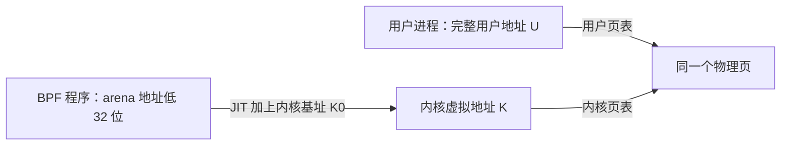
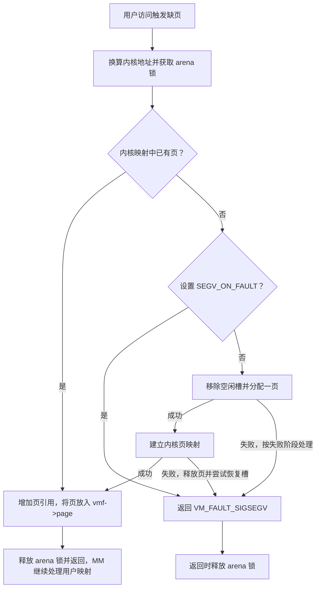

# BPF arena：用户态与 BPF 共享的稀疏内存

假设 BPF 程序维护一条链表，用户进程需要遍历同一批节点。除了节点内容，两边还需要约定：节点地址怎样表示，哪些地址已经有物理页，删除节点以后何时可以回收所在页。

`BPF_MAP_TYPE_ARENA` 提供这一机制中的页和地址空间管理。它先保留虚拟地址范围，再按需填入物理页；用户态与 BPF 通过不同的虚拟地址访问同一页。页内怎样划分链表节点、节点之间怎样同步，由上层使用者负责。文件开头说明了这种双重映射，实际的页分配、缺页和回收路径也围绕它展开（[arena.c：设计说明](../../linux/kernel/bpf/arena.c#L12-L39)）。

本章以 `linux/kernel/bpf/arena.c` 为主，补充阅读空闲区间管理、通用 map 接口、验证器和 x86-64 JIT。普通 map 的公共对象管理见 [map 章节](map.md)，这里重点回答：**一个 arena 地址如何在两侧找到同一页，以及这页如何出现和消失。**

## 0. 分析基线

本仓库内核版本为 **6.18.52**，本章选择 **x86-64、4 KiB 页**。版本与页大小分别依据 [Makefile](../../linux/Makefile#L2-L5)、[架构配置](../../linux/.config#L332-L339)、[页大小配置](../../linux/.config#L949-L954)。需要了解虚拟地址、页表、文件描述符、引用计数及互斥锁。

| 条件 | 对本章的影响 | 源码依据 |
| --- | --- | --- |
| `CONFIG_BPF_SYSCALL=y`、`CONFIG_MMU=y`、`CONFIG_64BIT=y` | 编入 `arena.o` 和 `range_tree.o` | [.config：BPF](../../linux/.config#L124)、[MMU 与位数](../../linux/.config#L332-L339)、[构建规则](../../linux/kernel/bpf/Makefile#L18-L20) |
| `CONFIG_BPF_JIT=y`，x86-64 JIT 支持 arena | 可以分析该架构的地址转换与异常修复；程序使用 arena 还要求加载时请求 JIT | [.config](../../linux/.config#L125-L127)、[`bpf_jit_supports_arena()`](../../linux/arch/x86/net/bpf_jit_comp.c#L3992-L3995)、[验证器检查](../../linux/kernel/bpf/verifier.c#L20857-L20878) |
| `CONFIG_MEMCG=y` | 页分配使用 map 所关联的内存 cgroup 记账 | [.config](../../linux/.config#L212)、[`bpf_map_alloc_pages()`](../../linux/kernel/bpf/syscall.c#L609-L638) |
| 未启用 `CONFIG_DEBUG_INFO_BTF` | 当前配置不能支持程序调用这里的 arena kfunc；不能把源码中存在的接口直接当作当前可运行功能 | [`CONFIG_PAHOLE_VERSION=0`](../../linux/.config#L26)、[BTF 配置依赖](../../linux/lib/Kconfig.debug#L377-L383)、[缺少内核 BTF 时拒绝 kfunc 调用](../../linux/kernel/bpf/verifier.c#L3330-L3338) |

最后一项并不等同于“没有 arena map 实现”：map 的构建条件和 kfunc 的加载条件不同。下文的 kfunc 路径解释其实现与成立条件，不表示已在当前配置上运行这些程序。分析期间不修改配置、不编译内核。

## 1. 整体认识：共享页，分别建立映射

先把三件事分开：保留虚拟地址、分配物理页、建立页表映射。创建 arena 时只准备内核虚拟区域和管理对象；用户 `mmap()` 建立用户虚拟内存区域（VMA）；实际的物理页可以由 BPF 显式分配，也可以由用户态缺页触发分配（[创建](../../linux/kernel/bpf/arena.c#L125-L148)、[mmap](../../linux/kernel/bpf/arena.c#L360-L397)、[缺页](../../linux/kernel/bpf/arena.c#L274-L315)）。

下图只展示一页已同时映射到两侧时的关系。实线箭头表示访问经过的映射，不表示两侧虚拟地址相等。



共享来自两份页表最终指向同一物理页。`arena_vm_fault()` 先用内核地址查页，找到后把该页交给用户缺页处理；找不到时才考虑新分配。因此，用户进程第一次访问某页，不一定会新分配一页（[arena.c#L282-L315](../../linux/kernel/bpf/arena.c#L282-L315)）。

| 触发入口 | 输入 | 主要输出 |
| --- | --- | --- |
| `BPF_MAP_CREATE` | 页数、map 标志、可选用户基址 | arena map 与 fd |
| `mmap(map_fd, ...)` | 用户地址、长度、共享映射属性 | 固定范围的用户 VMA |
| `bpf_arena_alloc_pages()` | 指定地址或自动选址、页数、NUMA 节点 | 用户地址形式的指针，失败为 `NULL` |
| 用户态缺页 | VMA 内的访问地址 | 已有页或新页；失败返回缺页错误 |
| `bpf_arena_free_pages()` | 地址、页数 | 撤销映射并归还页，无返回值 |

这些入口由 [`arena_map_ops`](../../linux/kernel/bpf/arena.c#L410-L428)、[`arena_vm_ops`](../../linux/kernel/bpf/arena.c#L318-L324) 和 [三个 kfunc](../../linux/kernel/bpf/arena.c#L602-L635) 连接起来。普通 key/value 操作不是这里的数据访问方式：lookup 返回 `ERR_PTR(-EINVAL)`，update、delete 等返回 `-EOPNOTSUPP`（[arena.c#L65-L88](../../linux/kernel/bpf/arena.c#L65-L88)、[#L200-L209](../../linux/kernel/bpf/arena.c#L200-L209)）。

## 2. 核心数据结构与地址模型

### 2.1 `bpf_arena` 管理什么

`bpf_arena` 嵌入公共的 `bpf_map`，通用 map 层通过这个嵌入成员找到 arena 对象。它没有保存一个按页编号索引的 `struct page *` 数组；查询实际存在的页时使用 `vmalloc_to_page()`（[结构定义](../../linux/kernel/bpf/arena.c#L45-L53)、[查页](../../linux/kernel/bpf/arena.c#L285-L289)）。

| 字段 | 含义与单位 | 关系和保护方式 |
| --- | --- | --- |
| `map` | 嵌入的公共 map 对象 | 复用 fd、类型、引用和记账机制 |
| `user_vm_start`、`user_vm_end` | 用户虚拟地址，单位为字节，范围为左闭右开 | 可由 `map_extra` 预先确定，或由第一次 mmap 确定 |
| `kern_vm` | 指向保留的内核 vmalloc 区域 | arena 在创建时取得，销毁时释放 |
| `rt` | 嵌入的 `range_tree` | 记录可分配的页槽区间，修改由 `arena->lock` 保护 |
| `vma_list` | 记录用户映射的链表头 | 每个记录保存 VMA 指针，用于逐一撤销用户映射 |
| `lock` | 互斥锁 | 串行化本文件中的映射登记、页槽分配、补页和释放操作 |

对应的初始化见 [arena.c#L133-L146](../../linux/kernel/bpf/arena.c#L133-L146)，加锁位置见 [mmap](../../linux/kernel/bpf/arena.c#L364)、[缺页](../../linux/kernel/bpf/arena.c#L285)、[分配](../../linux/kernel/bpf/arena.c#L470)、[释放](../../linux/kernel/bpf/arena.c#L545)。这把锁保护 arena 的管理状态，BPF 和用户态日常读写页内数据不会自动获取它。

用户映射记录 `struct vma_list` 包含 `vma`、链表节点 `head` 和引用计数 `mmap_count`。`remember_vma()` 将记录放入链表并保存在 `vm_private_data`；VMA 的 open/close 回调调整该计数，最后一次 close 才移除记录。它记录 VMA 的存在，并不因为保存了一个 VMA 指针就获得独立的 VMA 所有权（[arena.c#L222-L271](../../linux/kernel/bpf/arena.c#L222-L271)）。

### 2.2 三个容易混淆的量：用户地址、低 32 位、页槽编号

令：

```text
U0 = user_vm_start                  用户映射起点
U  = 一个用户态 arena 地址
K0 = kern_vm->addr + GUARD_SZ / 2   JIT 使用的内核基址
P  = PAGE_SIZE                     本配置为 4096 字节

内核访问地址 K = K0 + (u32)U
页槽编号 pgoff = (u32)(U - (u32)U0) >> PAGE_SHIFT
```

第一条是地址映射规则，第二条是相对于用户映射起点的页编号计算。**`(u32)U` 不是相对于 `U0` 的偏移。** 只有算 `pgoff` 时才减去用户基址的低 32 位。源码分别在 [基址访问函数](../../linux/kernel/bpf/arena.c#L55-L63)、[`compute_pgoff()`](../../linux/kernel/bpf/arena.c#L90-L93) 和 [缺页地址换算](../../linux/kernel/bpf/arena.c#L282-L283)。

用文件头的示例：`U0 = 0x7f7d26200000`、`K0 = 0xffffc90001e69000`。第一页的 `pgoff` 为 0，但内核地址是 `K0 + 0x26200000 = 0xffffc90028069000`，并不是 `K0` 本身（[arena.c#L16-L25](../../linux/kernel/bpf/arena.c#L16-L25)）。

这也解释了用户窗口不能跨越 4 GiB 边界：丢弃高 32 位以后，整个用户范围仍需是一段连续地址。创建时用起止地址的高 32 位比较检查这一条件；它不要求每个小于 4 GiB 的用户窗口都从 4 GiB 对齐地址开始（[arena.c#L117-L123](../../linux/kernel/bpf/arena.c#L117-L123)）。

### 2.3 为什么内核要保留 4 GiB 加保护区

BPF 指令的 `off` 是有符号 16 位偏移；x86 JIT 的 arena 访存把低 32 位地址、`K0` 和 `off` 相加。因此代码按整个低 32 位地址空间保留内核窗口，并在两端留保护区（[`bpf_insn.off`](../../linux/include/uapi/linux/bpf.h#L80-L86)、[arena.c#L27-L43](../../linux/kernel/bpf/arena.c#L27-L43)）。

在当前 4 KiB 页配置下，`GUARD_SZ = 64 KiB`，传给 `get_vm_area()` 的 `KERN_VM_SZ = 4 GiB + 64 KiB`。下图描述 arena 请求的布局，省略 vmalloc 自身的额外管理与保护空间：

```text
kern_vm->addr           K0                             K0 + 4 GiB
      | 左保护区 32 KiB | 可由低 32 位寻址的 4 GiB 窗口 | 右保护区 32 KiB |
                       |      仅部分页实际有映射       |
```

这里保留的是虚拟地址范围，不是在创建时消耗 4 GiB 物理内存。创建使用 `VM_SPARSE | VM_USERMAP`，实际补页调用的是 `vm_area_map_pages()`（[arena.c#L125](../../linux/kernel/bpf/arena.c#L125)、[稀疏区域映射实现](../../linux/mm/vmalloc.c#L728-L763)）。

### 2.4 `range_tree` 记录空闲槽，页表记录实际页

`rt` 可以理解为压缩存储的空闲位图：值为 1 表示可分配，清零表示被分配或被保留。它通过两棵树管理相同的 `range_node`：一棵按地址区间查重叠，一棵按区间大小选择能容纳请求的最合适范围（[range_tree.c#L9-L43](../../linux/kernel/bpf/range_tree.c#L9-L43)、[查找算法](../../linux/kernel/bpf/range_tree.c#L55-L83)）。源码头部“less or equal”的文字不能代替实际比较：实现选择的是长度**不小于**请求的空闲区间。

| 操作 | arena 中的含义 |
| --- | --- |
| `range_tree_set(rt, start, len)` | 将页槽标成可分配，按需合并相邻空闲区间 |
| `range_tree_clear(rt, start, len)` | 从空闲集合中移除区间，按需截短或拆分 |
| `is_range_tree_set(rt, start, len)` | 整段均空闲时返回 0，否则返回负值 |
| `range_tree_find(rt, len)` | 返回所选空闲段的起始页编号，无合适区间时返回 `-ENOENT` |

依据：[clear](../../linux/kernel/bpf/range_tree.c#L136-L181)、[整段检查](../../linux/kernel/bpf/range_tree.c#L183-L194)、[set](../../linux/kernel/bpf/range_tree.c#L196-L253)。初始化将 `[0, max_entries)` 全部设为空闲（[arena.c#L138-L141](../../linux/kernel/bpf/arena.c#L138-L141)）。

必须同时检查这两种状态：**空闲树中没有某个槽，不代表它已经有物理页。** `reserve_pages()` 正是只移除空闲槽而不创建页表映射的路径。

## 3. 关键算法：页如何出现、共享和消失

### 3.1 创建：先约束地址，再初始化空闲范围

`arena_map_alloc()` 接收 map 创建属性，成功返回嵌入的 `bpf_map` 指针，失败返回错误指针。下面是其类型特有的检查；通用 map 层还会先处理 token 等公共属性（[arena.c#L95-L123](../../linux/kernel/bpf/arena.c#L95-L123)、[公共 token 标志处理](../../linux/kernel/bpf/syscall.c#L1388-L1389)）。

| 属性 | 本实现的要求 |
| --- | --- |
| `key_size`、`value_size` | 都必须为 0 |
| `max_entries` | 非零，单位是页；乘以页大小后不能超过 4 GiB |
| `map_flags` | 必须有 `BPF_F_MMAPABLE`；类型层另外接受 `BPF_F_SEGV_ON_FAULT`、`BPF_F_NO_USER_CONV` |
| `map_extra` | 可选的用户映射起点，必须页对齐；与所需长度组合后不能跨 4 GiB 边界 |

随后按“内核虚拟区域 → arena 对象 → 初始空闲区间 → 互斥锁”的顺序准备资源。`map_extra` 非零时立即确定用户起止地址；为零时将地址确定推迟到 mmap。对象或空闲区间初始化失败，会释放此前取得的资源（[arena.c#L125-L151](../../linux/kernel/bpf/arena.c#L125-L151)）。

4 KiB 页下，4 GiB 对应最多 1,048,576 个页槽；这只是由源码限制计算出的容量上界，不是创建时分配的物理页数。创建权限由公共 map 层的 `CAP_BPF` 能力检查控制（[syscall.c#L1488-L1493](../../linux/kernel/bpf/syscall.c#L1488-L1493)）。

### 3.2 mmap：所有用户映射采用相同地址和长度

map 文件的 `.get_unmapped_area` 和 `.mmap` 分别分派到 arena 的地址选择和 VMA 初始化回调（[syscall.c#L1156-L1180](../../linux/kernel/bpf/syscall.c#L1156-L1180)、[arena_map_ops](../../linux/kernel/bpf/arena.c#L411-L417)）。

`arena_get_unmapped_area()` 拒绝非零 `pgoff` 和超过 4 GiB 的长度。用户地址范围已确定时，还要求传入地址、长度与记录一致。首次自动选址则用 `2 * len` 向 MM 查找空间：若前半段不会跨越 4 GiB 边界，直接使用；否则向上对齐到下一条 4 GiB 边界。查找较大空洞是为了选择地址，不代表最终创建两倍长度的 VMA（[arena.c#L326-L357](../../linux/kernel/bpf/arena.c#L326-L357)）。

`arena_map_mmap()` 在锁内再次检查地址和长度，登记 VMA，再保存 `user_vm_start/end`。第一个进程选定位置后，其他进程也必须使用相同位置，保证存放在共享内存中的完整用户指针对各进程具有相同含义。代码同时设置 `VM_DONTEXPAND | VM_DONTCOPY`，拒绝 split 和 mremap：fork 不会复制这段 VMA，局部拆分也不受支持（[arena.c#L360-L397](../../linux/kernel/bpf/arena.c#L360-L397)、[split/mremap 回调](../../linux/kernel/bpf/arena.c#L249-L257)）。

通用 map mmap 层要求共享映射，并清除 `VM_MAYEXEC`；arena 回调只登记地址和操作表，不在这里补齐物理页（[syscall.c#L1089-L1137](../../linux/kernel/bpf/syscall.c#L1089-L1137)）。

### 3.3 BPF 分配：选空闲槽，再映射物理页

`bpf_arena_alloc_pages(map, addr, page_cnt, node_id, flags)` 的包装层要求 map 类型正确、`flags == 0` 且页数非零，否则返回 `NULL`。内部算法如下，每一步都对应一类不同资源（[arena.c#L602-L611](../../linux/kernel/bpf/arena.c#L602-L611)）。

1. **检查范围。** NUMA 节点必须有效；请求页数不得超过用户窗口。指定地址时检查页对齐、换算 `pgoff` 并检查右边界。
2. **准备临时页指针数组。** `kvcalloc()` 分配 `page_cnt` 个指针。此时尚未拿到物理页。
3. **锁内占用虚拟页槽。** 指定地址时检查整段空闲；自动选址时调用 `range_tree_find()`；随后 clear 掉选中的空闲范围。
4. **分配物理页。** `bpf_map_alloc_pages()` 逐页分配，并在中途失败时释放已分配的页；连续的是 arena 虚拟地址，不要求物理页连续。
5. **建立内核映射。** 将这些页映射到 `K0 + (u32)(U0 + pgoff * P)` 开始的位置，释放临时数组，返回补回用户地址高 32 位后的指针。

算法依据：[检查和占槽](../../linux/kernel/bpf/arena.c#L439-L483)、[页分配和映射](../../linux/kernel/bpf/arena.c#L485-L510)、[逐页分配器](../../linux/kernel/bpf/syscall.c#L598-L638)。成功返回前仍没有为各用户 VMA 安装该页的用户 PTE；用户首次访问会走下一节的缺页路径。

失败也按资源区分：还没有占槽时，只释放临时数组；物理分配失败时，由分配器回收已有页，arena 再尝试将页槽设回空闲；内核映射返回错误时，arena 逐页释放并尝试恢复空闲范围。这里描述的是实际清理动作，不是对所有底层失败原子性的保证，第 6 节会说明限制。

页的记账对象来自 map 保存的 memcg 关系，不能因为分配发生在后来的缺页进程中，就认为一定记到该进程当前的 memcg。创建时保存关联，分配时临时切换 active memcg（[保存关联](../../linux/kernel/bpf/syscall.c#L483-L505)、[创建调用点](../../linux/kernel/bpf/syscall.c#L1602)、[分配记账](../../linux/kernel/bpf/syscall.c#L615-L637)）。

### 3.4 用户缺页：已有页复用，没有页才决定是否分配

`arena_vm_fault()` 用访问地址求出内核地址，在 `arena->lock` 保护下处理。其决策顺序很重要：



图保留了锁、复用、错误和引用变化；`guard(mutex)` 在作用域退出时释放锁。依据：[arena_vm_fault()](../../linux/kernel/bpf/arena.c#L274-L315)。

由这个顺序可以得到三个结论：

- **设置 `BPF_F_SEGV_ON_FAULT` 仍允许映射已经存在的页。** 标志检查发生在查页失败之后。其含义是禁止用户缺页隐式创建新页，不是禁止一切用户缺页。
- **新页也先进入内核映射，再交给用户 MM。** `page_ref_add(page, 1)` 后设置 `vmf->page`；最终用户 PTE 的建立由通用缺页流程继续完成，arena 回调没有直接修改用户 PTE。共享写缺页中的后续入口是 [`finish_fault()`](../../linux/mm/memory.c#L5785-L5824)。
- **本回调的分配失败也返回 `VM_FAULT_SIGSEGV`。** 不能将它改述为 `VM_FAULT_OOM`，或把一次 SIGSEGV 一律归因于用户地址越界。

### 3.5 保留：占据页槽但不填入物理页

`bpf_arena_reserve_pages()` 用于把一段地址从分配器的可用范围中拿走。内部先检查范围和整段空闲，再执行 `range_tree_clear()`，没有分配物理页或建立映射。越界返回 `-EINVAL`，已有部分被占用返回 `-EBUSY`（[arena.c#L572-L598](../../linux/kernel/bpf/arena.c#L572-L598)、[包装层](../../linux/kernel/bpf/arena.c#L624-L635)）。

保留与填页是两种独立状态。后续 `alloc_pages()` 不能在保留范围内分配；但在未设置 `BPF_F_SEGV_ON_FAULT` 时，用户缺页仍可能为该地址创建页。原因是缺页路径直接调用 `range_tree_clear()`，没有先检查整段空闲，而 clear 对已经不在空闲树中的区间可以返回成功。这是从两段实现组合得到的结论，不能把 reserve 当作用户态的永久访问保护（[缺页调用点](../../linux/kernel/bpf/arena.c#L291-L310)、[clear 实现](../../linux/kernel/bpf/range_tree.c#L137-L180)）。

### 3.6 释放：先撤用户映射，再撤内核映射

`bpf_arena_free_pages()` 不返回错误码。包装层过滤错误 map 类型、零页数和空指针；内部只采用地址的低 32 位，将它向下页对齐，补回 arena 的用户地址高位，并将释放终点截到用户窗口内（[arena.c#L527-L543](../../linux/kernel/bpf/arena.c#L527-L543)、[包装层](../../linux/kernel/bpf/arena.c#L614-L621)）。

锁内先把页槽设回空闲，然后处理映射。这个先后顺序不意味着其他分配入口能立刻复用槽：它们还需要取得同一把 arena 锁。映射处理分为：

1. 多页释放时，先遍历 `vma_list`，对每个用户 VMA 批量调用 `zap_page_range_single()`。
2. 逐页用内核地址查找物理页，没有页就跳过。释放单页时，仅在 `page_mapped()` 为真时撤销用户映射，以避免无必要的遍历。
3. 调用 `vm_area_unmap_pages()` 撤销该页的内核映射，再 `__free_page()` 归还页。

依据：[zap_pages()](../../linux/kernel/bpf/arena.c#L518-L525)、[释放主体](../../linux/kernel/bpf/arena.c#L545-L569)。底层 `vunmap_range()` 清页表并刷新内核 TLB，因此这里不能简化为“只清掉一个指针”（[vm_area_unmap_pages()](../../linux/mm/vmalloc.c#L771-L778)、[vunmap_range()](../../linux/mm/vmalloc.c#L519-L533)）。

保留而未分配的页槽也能通过该接口归还：set 操作恢复空闲状态，查不到物理页时直接跳过。仓库自测试专门把已分配页和保留页放在一次 free 中验证这一语义（[verifier_arena_large.c#L133-L165](../../linux/tools/testing/selftests/bpf/progs/verifier_arena_large.c#L133-L165)）。这里只引用测试意图，未运行该测试。

释放页不会删除用户 VMA。地址仍在 VMA 内，下一次用户访问可能再次补页，或在 `BPF_F_SEGV_ON_FAULT` 条件下失败。因此“释放页”与“munmap 用户窗口”是不同操作。

### 3.7 销毁 map：最后收回整个地址区域

`arena_map_free()` 首先检查 VMA 链表是否为空；源码明确说明 `mmap()` 的 `vm_file` 持有文件，而文件持有 map 引用，因此 map 最终销毁前用户 VMA 应已关闭。检查不满足时会告警并返回（[arena.c#L174-L185](../../linux/kernel/bpf/arena.c#L174-L185)）。

BPF 程序也通过通用 `used_maps` 路径持有 map：验证器增加引用，程序释放时归还引用。因此，仅关闭创建 map 的 fd 并不等于销毁 arena（[取得引用](../../linux/kernel/bpf/verifier.c#L20899-L20913)、[归还引用](../../linux/kernel/bpf/core.c#L2902-L2923)）。

销毁阶段遍历内核 4 GiB 窗口中已存在的 PTE，释放仍存在的页；随后 `free_vm_area()` 收回内核映射区域，再销毁空闲树和 arena 对象。回调 `existing_page_cb()` 本身并不逐项清 PTE，源码明确依赖此时已无人合法访问，并把最终解除映射交给后续区域销毁。不能把这种顺序直接用于仍有使用者的单页释放路径（[arena.c#L154-L197](../../linux/kernel/bpf/arena.c#L154-L197)）。

## 4. 实现接口：验证器与 x86 JIT 怎样完成访问

### 4.1 加载时先确定唯一 arena 和用户基址

验证器要求一个程序最多关联一个 arena，检查 BPF 与性能监测相关能力、JIT 请求和架构支持；还要求用户基址已经由 `map_extra` 或先前 mmap 确定。关联保存在 `prog->aux->arena`，map 的实际引用则由 `used_maps` 管理（[verifier.c#L20857-L20878](../../linux/kernel/bpf/verifier.c#L20857-L20878)、[#L20884-L20913](../../linux/kernel/bpf/verifier.c#L20884-L20913)）。

所以当创建时没有指定 `map_extra`，需要先 mmap 确定基址，再加载使用它的程序。这样 JIT 生成代码时，内核基址和用户地址高位已经确定。

三个页管理 kfunc 都带 `KF_SLEEPABLE` 和 `KF_ARENA_ARG2`，分配函数还带 `KF_ARENA_RET`；它们在初始化阶段注册到公共 kfunc 集合。公共注册不意味着所有程序、所有执行状态都能调用：验证器会拒绝在非可睡眠状态调用可睡眠 kfunc，通用 kfunc 路径也检查 BTF、JIT 与 GPL 兼容许可证（[arena.c#L639-L654](../../linux/kernel/bpf/arena.c#L639-L654)、[可睡眠检查](../../linux/kernel/bpf/verifier.c#L14035-L14043)、[通用条件](../../linux/kernel/bpf/verifier.c#L3330-L3348)）。直接读取已有 arena 页与调用这些管理接口，要分别判断上下文条件。

### 4.2 地址转换与访存改写

验证器把相应地址空间转换得到的寄存器标记为 `PTR_TO_ARENA`，按 32 位地址处理；arena 指针算术允许较自由的操作，64 位运算必要时改写为 32 位。访存最终改写成 `BPF_PROBE_MEM32` 等内部指令，并分配异常表项（[地址类型](../../linux/kernel/bpf/verifier.c#L15990-L16035)、[算术规则](../../linux/kernel/bpf/verifier.c#L15782-L15799)、[访存改写](../../linux/kernel/bpf/verifier.c#L21818-L21829)）。

x86 JIT 将 `K0` 装入原生寄存器 `r12`，对 arena 的普通 load/store 使用“arena 地址寄存器 + r12 + 指令偏移”的有效地址。`r12` 是这里的 JIT 内部用途，不是新增一个 BPF 可见寄存器（[装载基址](../../linux/arch/x86/net/bpf_jit_comp.c#L1658-L1672)、[访存生成](../../linux/arch/x86/net/bpf_jit_comp.c#L2117-L2144)）。

返回用户地址表示时，JIT 补回用户窗口的高 32 位，并对低 32 位为零的情况保留空指针语义。`BPF_F_NO_USER_CONV` 会让验证器把对应转换改为清高位的普通 32 位 move，不能将该标志理解为“禁止 mmap”或“不给用户权限”（[x86 用户地址转换](../../linux/arch/x86/net/bpf_jit_comp.c#L1722-L1753)、[标志对应的改写](../../linux/kernel/bpf/verifier.c#L22464-L22474)）。

### 4.3 BPF 访问未映射页不会自动分配

用户态缺页走 `arena_vm_fault()`；BPF JIT 访问内核窗口中的未映射地址，则由 JIT 异常表引导到 `ex_handler_bpf()`。对普通读取，处理器将目标寄存器清零并跳过出错指令；对普通写入，跳过出错指令。此路径没有调用 arena 页分配器（[异常表记录](../../linux/arch/x86/net/bpf_jit_comp.c#L2170-L2197)、[异常处理](../../linux/arch/x86/net/bpf_jit_comp.c#L1449-L1471)）。

处理器还调用 `bpf_prog_report_arena_violation()`：按出错指令地址找到程序，使用主程序的输出流，将 arena 地址补为用户地址形式，并尝试输出读写错误和堆栈。这是诊断路径，不代表向用户进程发送与 `BPF_F_SEGV_ON_FAULT` 相同的信号（[arena.c#L656-L684](../../linux/kernel/bpf/arena.c#L656-L684)）。

这一机制限制了错误地址对内核其他内存的影响，但不替上层保证对象生命周期。已经释放又重新分配的地址可能指向新对象，旧指针也可能仍指向一张有效页；此时不能期待“未映射访问修复”检测出逻辑上的悬空指针。这个边界是根据地址复用和异常触发条件作出的分析。

## 5. 用一页的生命周期串起调用关系

下面用显式分配一页的路径复盘。假定地址窗口已经确定，程序满足权限、BTF、JIT 和可睡眠要求；它描述源码中的合法顺序，不是当前配置的运行记录。

| 阶段 | 主要入口 | 页槽状态 | 映射状态 |
| --- | --- | --- | --- |
| 创建 map | `arena_map_alloc()` | 初始化为空闲 | 保留内核虚拟区域，尚未填页 |
| 建立用户窗口 | `arena_map_mmap()` | 不变 | 用户 VMA 已登记，目标页尚无用户映射 |
| BPF 分配一页 | `arena_alloc_pages()` | 从空闲树移除 | 分配物理页并建立内核映射 |
| BPF 写入 | JIT 生成的 arena store | 不变 | 经内核地址访问该物理页 |
| 用户首次读取 | `arena_vm_fault()` | 已占用 | 复用已有物理页，MM 完成用户映射 |
| 应用同步后回收 | `arena_free_pages()` | 归还为空闲 | 撤销用户和内核映射，再归还页 |
| 最后退出 | `arena_vm_close()`、`arena_map_free()` | 最终销毁 | 删除 VMA 记录并回收内核区域 |

表中状态来自前述[分配](../../linux/kernel/bpf/arena.c#L470-L510)、[缺页](../../linux/kernel/bpf/arena.c#L285-L315)、[释放](../../linux/kernel/bpf/arena.c#L545-L569)与[关闭和销毁](../../linux/kernel/bpf/arena.c#L174-L197)路径。“应用同步后回收”是对使用者协议的要求：arena 管理锁没有包围用户态或 BPF 的每一次普通内存访问。

如果需要观察它在真实数据结构中的用途，可继续阅读仓库的链表示例：BPF 在 arena 内分配节点并连接，用户侧遍历同一条链表求和。页内的 `bpf_alloc()` 是示例的上层分配机制，不是 `arena.c` 直接提供的对象粒度接口（[BPF 示例](../../linux/tools/testing/selftests/bpf/progs/arena_list.c#L45-L64)、[用户侧遍历与检查](../../linux/tools/testing/selftests/bpf/prog_tests/arena_list.c#L20-L59)）。

## 6. 并发、边界与容易误读的实现

### 6.1 管理锁和数据同步负责不同事情

| 对象或动作 | 本实现提供的保护 | 使用者仍需负责的部分 |
| --- | --- | --- |
| 空闲树、内核补页与撤映射 | `arena->lock` 串行化相关管理入口 | 不将页槽状态当作对象内存安全证明 |
| VMA 记录链表 | 登记和移除在锁内；free 遍历时也在锁内 | 不将保存 VMA 指针理解为额外的 map 引用 |
| 同一页的用户/BPF 普通读写 | 两侧共享实际物理页 | 数据结构锁、原子操作、发布顺序与回收协议 |
| map 对象本身 | 文件引用、程序 `used_maps` 引用及通用销毁流程 | 区分关闭 fd、munmap、释放页和销毁 map |

源码依据：[VMA 记录](../../linux/kernel/bpf/arena.c#L228-L271)、[页操作锁](../../linux/kernel/bpf/arena.c#L470-L498)、[回收锁](../../linux/kernel/bpf/arena.c#L545-L569)、[map 销毁前提](../../linux/kernel/bpf/arena.c#L174-L185)、[程序引用](../../linux/kernel/bpf/verifier.c#L20903-L20913)。这里的并发结论针对管理接口，不能扩展为“持锁释放页就已与所有直接内存访问同步”。

### 6.2 按实际代码保留这些边界

1. **首次 mmap 的长度检查有条件。** `map_extra` 为零、用户范围尚未确定时，`arena_get_unmapped_area()` 没有要求 `len == max_entries * PAGE_SIZE`；严格的地址和长度匹配发生在用户范围已确定之后。初始空闲树仍按 `max_entries` 建立，分配器的 `page_cnt_max` 又取用户范围长度。因此本文正常路径令两者一致，不把“一定相等”写成无条件不变量（[地址选择](../../linux/kernel/bpf/arena.c#L334-L349)、[初始空闲范围](../../linux/kernel/bpf/arena.c#L140-L141)、[运行时页数](../../linux/kernel/bpf/arena.c#L439-L442)）。

2. **reserve 的未对齐地址返回 0，却不做保留。** 这是当前实现的字面行为；不能因为返回 0 就推导出这类输入已成功保留。分配接口则拒绝未对齐地址，释放接口将地址向下对齐，三个入口的规则不同（[reserve](../../linux/kernel/bpf/arena.c#L582-L583)、[alloc](../../linux/kernel/bpf/arena.c#L456-L462)、[free](../../linux/kernel/bpf/arena.c#L533-L535)）。

3. **范围树的修改和回滚并非已证明的事务。** `range_tree_clear()` 拆分区间时先修改左段，再分配右段节点；节点分配失败会返回错误。分配、缺页失败后的 `range_tree_set()` 恢复调用也没有检查返回值。因此只能说明“尝试恢复空闲范围”，不能保证所有内存不足分支都完全回到调用前状态（[拆分失败顺序](../../linux/kernel/bpf/range_tree.c#L143-L160)、[缺页恢复](../../linux/kernel/bpf/arena.c#L299-L310)、[分配恢复](../../linux/kernel/bpf/arena.c#L499-L510)）。这是静态检查得到的限制，未做故障注入验证。

4. **`map_mem_usage()` 返回 0 不表示不占内存。** 本类型没有通过该回调报告页用量；实际页仍通过 `bpf_map_alloc_pages()` 分配和记账（[arena 回调](../../linux/kernel/bpf/arena.c#L217-L220)、[实际分配](../../linux/kernel/bpf/syscall.c#L609-L638)）。

5. **个别注释已不足以描述当前实现。** `arena_alloc_pages()` 上方仍提到 `alloc_pages_bulk()`，但实际调用链是 `bpf_map_alloc_pages()` 逐页调用 `__bpf_alloc_page()`；分析分配粒度和失败清理应以调用实现为准（[旧注释与调用点](../../linux/kernel/bpf/arena.c#L465-L485)、[实际循环](../../linux/kernel/bpf/syscall.c#L621-L631)）。

另外，`arena_map_direct_value_addr()` 只检查偏移并返回用户基址，它不分配页；`arena_map_check_btf()` 返回 0 也不取消程序调用 kfunc 时的内核 BTF 要求。两者分别服务于 map 的通用接口契约（[arena.c#L400-L407](../../linux/kernel/bpf/arena.c#L400-L407)、[#L211-L215](../../linux/kernel/bpf/arena.c#L211-L215)）。

## 7. 回顾与源码阅读路线

arena 的核心状态由三部分组成：用户地址范围决定两侧如何解释指针，空闲树决定页分配接口还能选哪些槽，页表决定这些地址实际是否有物理页。保留、补页和释放分别改变其中不同的部分，因而必须分别推演。

阅读源码时可以按以下顺序复查，而不必从文件头逐行向下：

1. [`bpf_arena` 与地址换算](../../linux/kernel/bpf/arena.c#L45-L93)：先明确对象和单位。
2. [创建](../../linux/kernel/bpf/arena.c#L95-L152)与[mmap](../../linux/kernel/bpf/arena.c#L326-L397)：确定地址范围。
3. [显式分配](../../linux/kernel/bpf/arena.c#L439-L511)与[用户缺页](../../linux/kernel/bpf/arena.c#L274-L315)：比较两种填页入口。
4. [保留](../../linux/kernel/bpf/arena.c#L572-L598)、[释放页](../../linux/kernel/bpf/arena.c#L518-L570)与[销毁 map](../../linux/kernel/bpf/arena.c#L154-L198)：区分撤映射与对象生命周期。
5. [验证器兼容性检查](../../linux/kernel/bpf/verifier.c#L20857-L20878)和[x86 异常处理](../../linux/arch/x86/net/bpf_jit_comp.c#L1449-L1471)：理解 BPF 访存的成立条件与失败语义。
