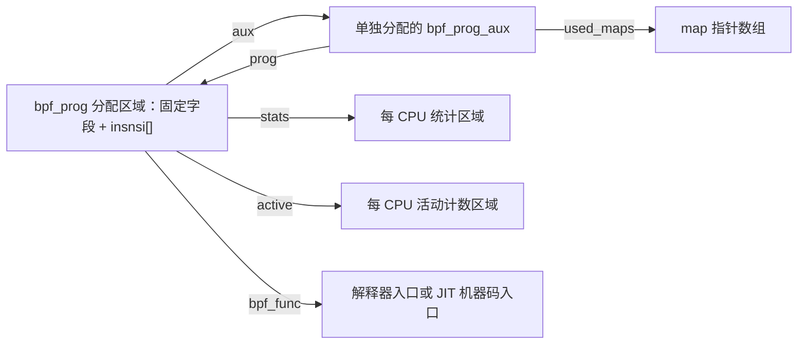
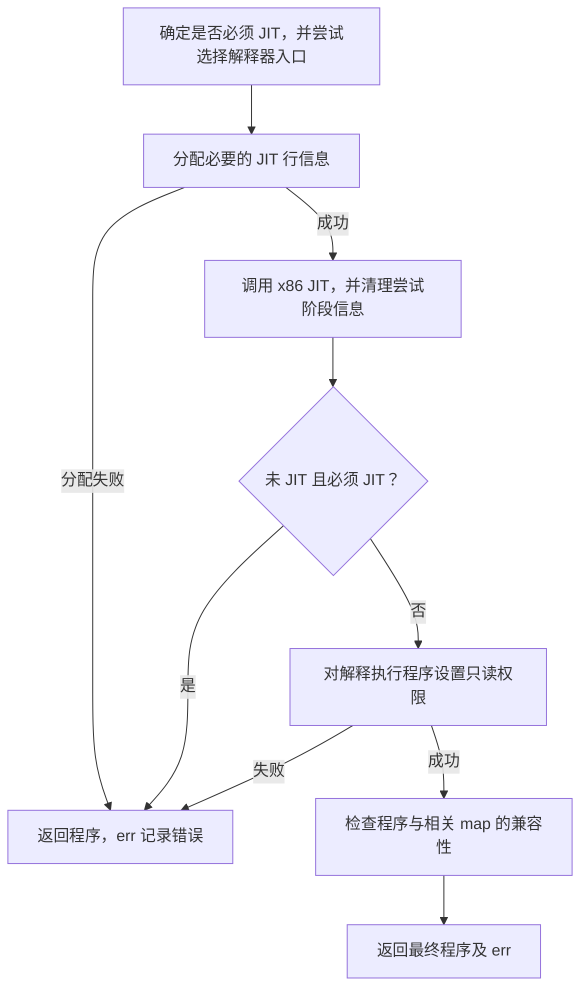
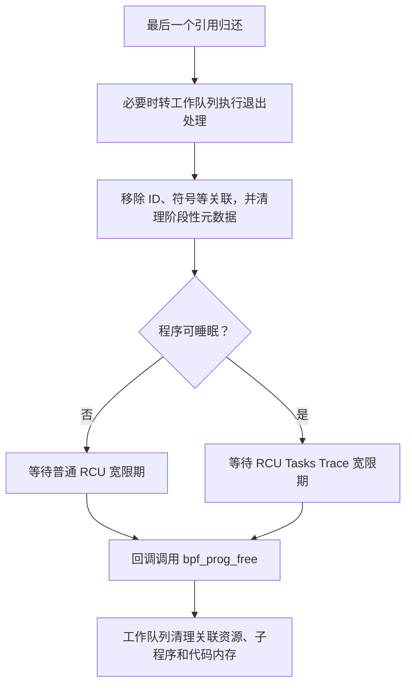

# BPF 程序执行核心：`core.c` 源码分析

用户态提交一段 BPF 指令后，内核需要把它变成一个可以被挂载点调用的程序：建立程序对象，保存验证结果，选择解释器或即时编译器（Just-In-Time compiler，JIT），并在最后一个持有者退出后回收资源。`linux/kernel/bpf/core.c` 将这些公共机制连接起来。本章围绕“程序从指令数组变成运行入口，再退出可见范围并释放”的过程展开。[程序分配](../../linux/kernel/bpf/core.c#L100-L174) · [运行时选择](../../linux/kernel/bpf/core.c#L2562-L2615) · [资源回收](../../linux/kernel/bpf/core.c#L2947-L2995)

阅读前需要了解 C 函数指针、柔性数组和引用计数；涉及的 RCU、每 CPU 数据与锁可参考[锁机制基础](../lock/introduction.md)。BPF 的挂载点和加载接口见[子系统概述](introduction.md)，对象之间更完整的关系见[核心数据结构](核心数据结构.md)。本章只展开理解 `core.c` 所需的验证器和 x86-64 JIT 接口，不逐条分析验证算法或机器码编码。

## 0. 分析基线与边界

本章依据本地 [Makefile 第 2～4 行](../../linux/Makefile#L2-L4)标记的 **Linux 6.18.52**，架构为 **x86-64**。[架构配置](../../linux/.config#L332-L334)

| 条件 | 对本章主线的影响 | 源码依据 |
| --- | --- | --- |
| `CONFIG_BPF=y`、`CONFIG_BPF_SYSCALL=y` | 编入 BPF 核心、加载接口和验证器 | [.config](../../linux/.config#L117-L124) · [目录构建条件](../../linux/kernel/Makefile#L123) · [对象构建规则](../../linux/kernel/bpf/Makefile#L2-L11) |
| `CONFIG_HAVE_EBPF_JIT=y`、`CONFIG_BPF_JIT=y` | 当前构建具有 eBPF JIT，x86-64 编译器位于 `arch/x86/net/bpf_jit_comp.c` | [.config](../../linux/.config#L118-L125) · [x86 构建规则](../../linux/arch/x86/net/Makefile#L6-L10) |
| `CONFIG_BPF_JIT_DEFAULT_ON=y` | `bpf_jit_enable` 初值为 1 | [.config](../../linux/.config#L127) · [初值](../../linux/kernel/bpf/core.c#L543-L549) |
| `CONFIG_BPF_JIT_ALWAYS_ON` 未启用 | 解释器被编入；满足解释执行条件的程序可以在 JIT 未成功时回退 | [.config](../../linux/.config#L126) · [解释器编译条件](../../linux/kernel/bpf/core.c#L1777) · [选择逻辑](../../linux/kernel/bpf/core.c#L2528-L2595) |
| `CONFIG_PREEMPT_RCU=y`、`CONFIG_TASKS_TRACE_RCU=y` | 普通程序和可睡眠程序的回收使用不同的 RCU 协议 | [.config](../../linux/.config#L167-L175) · [回收分支](../../linux/kernel/bpf/syscall.c#L2406-L2413) |

配置决定代码是否编入，不能证明某次加载一定采用 JIT。运行时开关通过 sysctl 暴露，分配程序时 `jit_requested` 记录当时 `ebpf_jit_enabled()` 的结果；即使请求了 JIT，编译也可能失败。[sysctl 入口](../../linux/net/core/sysctl_net_core.c#L439-L445) · [分配时记录请求](../../linux/kernel/bpf/core.c#L123-L128) · [开关判断](../../linux/include/linux/filter.h#L1377-L1380)

本地 `.config` 没有启用 `CONFIG_DEBUG_INFO_BTF`，且 `CONFIG_PAHOLE_VERSION=0`，不满足该选项要求的 `PAHOLE_VERSION >= 116`。因此当前配置不会解析 vmlinux BTF，kfunc 调用会在验证阶段因缺少内核 BTF 被拒绝。本章仍解释 `core.c` 中“含 kfunc 调用时必须 JIT”的通用判断，但它不表示当前配置能够加载这类程序。[本地 pahole 配置](../../linux/.config#L26) · [BTF 配置依赖](../../linux/lib/Kconfig.debug#L377-L383) · [vmlinux BTF 获取](../../linux/kernel/bpf/verifier.c#L24432-L24452) · [kfunc 拒绝条件](../../linux/kernel/bpf/verifier.c#L3330-L3338)

正文以通过 `bpf()` 加载、由本机软件执行的 eBPF 程序为主线。设备卸载程序在运行时选择阶段转交卸载编译接口；经典 BPF 的报文访问兼容代码和其他配置分支只在有助于理解文件职责时说明。[卸载分支](../../linux/kernel/bpf/core.c#L2585-L2600)

## 1. 整体流程：加载建立入口，事件触发执行

`core.c` 位于加载验证与实际执行之间。`syscall.c` 分配并填充程序，`verifier.c` 检查和改写指令；随后 `bpf_prog_select_runtime()` 确定运行形态。成功后，加载接口分配 ID、注册相关通知，再创建程序文件描述符。[分配和指令复制](../../linux/kernel/bpf/syscall.c#L2993-L3023) · [验证至创建 fd](../../linux/kernel/bpf/syscall.c#L3089-L3123)

下图表示加载路径中的**主要处理顺序**，省略属性检查和失败清理，也不展开验证器内部可能已经完成的子程序 JIT：


图的重点是：指令提交、验证通过、具备可用运行入口、向其他持有者公开，是不同阶段。加载接口在 `bpf_prog_alloc_id()` 成功后将程序视为公开对象，从这时起的失败清理必须使用程序引用释放路径。[公开边界说明](../../linux/kernel/bpf/syscall.c#L3098-L3122)

事件发生时，挂载点或其他调用方提供上下文 `ctx`，再调用程序入口。上下文的内容、返回值怎样影响调用方，取决于程序类型和挂载点；通用执行函数只负责分派和可选统计。[通用运行函数](../../linux/include/linux/filter.h#L732-L763)

## 2. 核心对象：程序内存、辅助信息和运行入口

### 2.1 指令槽与程序对象

`struct bpf_insn` 包含一个字节的操作码、源和目的寄存器编号、16 位有符号偏移 `off`、32 位有符号立即数 `imm`。在当前 x86-64 布局下，一个指令槽占 8 字节；加载 64 位立即数的指令使用连续两个槽。因此 `prog->len` 表示指令槽数量，不能直接等同于 C 语句数或机器码字节数。[指令定义](../../linux/include/uapi/linux/bpf.h#L80-L86) · [双槽立即数执行](../../linux/kernel/bpf/core.c#L1913-L1916)

`bpf_prog` 保存执行直接需要的信息，`bpf_prog_aux` 保存验证结果、资源关联和生命周期状态。以下只列本章主线中的字段：

| 字段 | 含义、单位或关系 |
| --- | --- |
| `prog->pages` | 程序对象及其尾部指令区分配的页数 |
| `prog->len`、`insnsi[]` | 指令槽数，以及嵌入分配区域尾部的柔性数组 |
| `jit_requested`、`jited` | 分别表示请求 JIT、已经成功生成机器码 |
| `blinding_requested`、`blinded` | 分别表示请求常量盲化、已完成盲化 |
| `bpf_func`、`jited_len` | 运行入口，以及 JIT 代码的字节数 |
| `stats`、`active` | 指向分别分配的每 CPU 统计和活动计数区域 |
| `aux->refcnt` | 程序的原子引用计数 |
| `aux->stack_depth` | 验证得到的栈深度，单位为字节 |
| `aux->used_maps`、`used_btfs` | 程序使用的 map 和 BTF/模块关联集合，销毁时归还相应引用 |
| `aux->func`、`main_prog_aux` | 子程序指针数组，以及关联主程序辅助信息的指针 |
| `aux->ksym`、`linfo`、`jited_linfo` | 嵌入的符号对象、BPF 行信息和对应机器码地址信息 |

字段定义见 [`bpf_prog`](../../linux/include/linux/bpf.h#L1701-L1737)、[`bpf_prog_aux`](../../linux/include/linux/bpf.h#L1588-L1699)和[统计结构](../../linux/include/linux/filter.h#L702-L707)。`used_maps` 的锁和回收协议见[兼容性检查](../../linux/kernel/bpf/core.c#L2505-L2525)与[引用归还](../../linux/kernel/bpf/core.c#L2902-L2944)。

### 2.2 包含关系和指针关系

下图中箭头均表示**指针关联**，方框中的 `insnsi[]` 表示包含在同一分配区域中的指令区；图省略子程序、BTF 和其他资源：



`aux` 与程序区域分别分配，`stats` 和 `active` 又是独立的每 CPU 分配。`aux->prog` 是反向关联，不能仅凭这个指针认定它另持有一份程序引用；引用计数的增减需要沿持有者的实际操作核对。[分别分配与初始化](../../linux/kernel/bpf/core.c#L100-L174) · [引用计数释放](../../linux/kernel/bpf/syscall.c#L2429-L2445)

程序对象也不保存每次解释执行的全部现场。解释器入口为本次调用建立寄存器数组和栈，设置上下文参数与帧指针，再执行 `insnsi`。[执行现场](../../linux/kernel/bpf/core.c#L2341-L2369)

## 3. 创建与指令改写：保持对象关系和控制流

### 3.1 分配、失败回滚和扩容

`bpf_prog_alloc_no_stats(size, flags)` 的 `size` 是所需字节数，函数将其按页向上对齐，再依次分配程序区域、`aux` 和每 CPU 的 `active`。成功后建立 `fp->aux`、`aux->prog`、`aux->main_prog_aux`，记录 JIT/盲化请求，并初始化相关锁和符号链表节点。[实现](../../linux/kernel/bpf/core.c#L100-L145)

`bpf_prog_alloc()` 继续分配每 CPU 统计区域并初始化同步状态。程序区域分配失败直接返回 `NULL`；`aux`、`active` 或统计区域分配失败时，分别清理此前已取得的资源。这里使用 `GFP_KERNEL` 系列分配标志，是加载、准备阶段的接口，不能套用到任意中断执行路径。[分配与回滚](../../linux/kernel/bpf/core.c#L100-L173)

指令扩张时，`bpf_prog_realloc()` 先检查现有页数是否足够：足够就返回原程序，不缩小分配；不足则分配更大的区域、复制原内容并更新 `aux->prog`。成功后清空旧对象的 `aux`、`stats`、`active`，再用 `__bpf_prog_free()` 释放旧区域。这表示辅助资源转交新对象，而不是重新创建或重复释放。[扩容](../../linux/kernel/bpf/core.c#L255-L282) · [底层释放](../../linux/kernel/bpf/core.c#L285-L296)

调用者必须使用返回的新指针；若新分配失败，函数返回 `NULL`，旧对象仍存在。后续改写函数正是先检查扩容是否成功，再改变指令长度和内容。[扩容调用点](../../linux/kernel/bpf/core.c#L481-L486)

### 3.2 一条指令替换为多条，跳转怎样保持正确

验证器或 JIT 准备过程可能把一条指令换成多条。`bpf_patch_insn_single(prog, off, patch, len)` 的 `off` 是指令槽索引，`len` 是替换片段的槽数，增加的槽数为 `len - 1`。当 `len == 1` 时直接覆盖；发生扩张时依次扩容、移动尾部、写入补丁、修正分支偏移和行信息。[改写入口](../../linux/kernel/bpf/core.c#L452-L510)

其关键不变量是：**原来跨过改写区域的控制流，在插入指令后仍到达相应的原目标。** 相对跳转目标按下式计算：

```text
目标槽索引 = 当前槽索引 + 相对偏移 + 1
```

例如，一条位于改写区域之前的跳转，目标位于区域之后；增加两个槽后，其偏移也需要增加 2。位于后方、向前跨过该区域的跳转，则要减小偏移。普通短跳转使用 16 位 `off`，`JMP32 | JA` 使用 32 位 `imm`；相对子程序调用和伪函数地址也有对应的 `imm` 调整路径。[偏移修改](../../linux/kernel/bpf/core.c#L336-L383) · [分类处理](../../linux/kernel/bpf/core.c#L385-L429)

当扩张后的指令数量可能超出短跳转范围时，代码先以 `probe_pass=true` 检查溢出，出错返回 `ERR_PTR(-ERANGE)`，随后才允许扩容和正式改写。扩容失败返回 `ERR_PTR(-ENOMEM)`。正式移动内容以后，代码以 `BUG_ON()` 检查偏移调整不应再失败的约束，避免把无法回滚的半成品交给调用者。[预检查与错误返回](../../linux/kernel/bpf/core.c#L468-L484) · [正式修改](../../linux/kernel/bpf/core.c#L498-L508)

`bpf_remove_insns()` 则移动后续指令、减小 `len` 并调整分支；源码说明缩短程序不会导致分支偏移扩张溢出，因此不做同样的预检查。它没有在函数内调用 `bpf_adj_linfo()`，不能将删除函数概括为自动完成所有附加元数据的更新。[删除实现](../../linux/kernel/bpf/core.c#L513-L527)

## 4. 确定运行形态：请求 JIT、完成 JIT 与允许回退

### 4.1 `bpf_prog_select_runtime()` 的接口契约

此函数接收已经填充的程序，通过返回值交回最终程序，通过 `*err` 报告成功或负错误码。它本身的失败分支仍返回有效程序指针，不使用 `ERR_PTR()`；JIT 常量改写可能改变程序对象，所以调用者既要接住指针，也要检查 `err`。加载接口采用的原始代码如下：[函数实现](../../linux/kernel/bpf/core.c#L2562-L2615) · [调用点](../../linux/kernel/bpf/syscall.c#L3094-L3096)

```c
prog = bpf_prog_select_runtime(prog, &err);
if (err < 0)
	goto free_used_maps;
```

### 4.2 正常软件执行路径

对尚未建立 `bpf_func` 的普通软件程序，函数先选择可用解释器入口，再调用架构 JIT。这样架构编译器没有生成机器码时，程序仍可能保留解释器入口；成功与否由 `jited` 表示。[准备解释器与 JIT](../../linux/kernel/bpf/core.c#L2572-L2595)

下图表示这一分支的**处理顺序与失败分支**，省略已有入口和设备卸载分支：



图中“允许继续”可能表示 JIT 成功，也可能表示满足条件的解释器回退。`bpf_prog_lock_ro()` 只对当前配置下未 JIT 的程序区域设置只读权限；JIT 机器码的权限由代码分配路径管理，不能把这一步解释为总是对所有程序区域设为只读。[只读处理](../../linux/include/linux/filter.h#L1109-L1118)

有三类条件使此函数要求 JIT：启用 `CONFIG_BPF_JIT_ALWAYS_ON`、程序含 kfunc 调用、无法选择合适解释器入口。解释器覆盖 32～512 字节的栈大小，如果计算出的入口索引超出数组，设置的是告警占位入口，并把 JIT 视为必要条件。必须 JIT 而未成功时返回 `-ENOTSUPP`。[必要条件](../../linux/kernel/bpf/core.c#L2572-L2595) · [解释器边界](../../linux/kernel/bpf/core.c#L2528-L2549)

回退还受验证器限制：含 kfunc、BPF 子程序调用与尾调用组合、伪函数地址回调等程序，不能简单地在 JIT 失败后交给解释器。验证器在准备调用时已检查这些条件。[验证器回退限制](../../linux/kernel/bpf/verifier.c#L22199-L22229)

### 4.3 已有入口、卸载路径和兼容性检查

如果 `fp->bpf_func` 已建立，函数直接进入收尾；源码说明 BPF 子程序相关的 JIT 准备可能已由验证器完成。设备卸载程序调用 `bpf_prog_offload_compile()`，其错误同样通过 `*err` 返回。[已有入口分支](../../linux/kernel/bpf/core.c#L2564-L2570) · [卸载分支](../../linux/kernel/bpf/core.c#L2596-L2600)

最后的 `bpf_check_tail_call()` 持有 `aux->used_maps_mutex`，遍历包含程序的 map；兼容性检查再使用 `map->owner_lock` 保护 owner 信息。比较内容包括解析后的程序类型、实际 `jited` 状态、XDP 分片属性，以及适用的挂载类型、cgroup storage cookie 和函数原型。检查放在运行时选择之后，因为此时才能知道最终是 JIT 还是解释执行。[检查范围与锁](../../linux/kernel/bpf/core.c#L2428-L2489) · [集合遍历](../../linux/kernel/bpf/core.c#L2505-L2525) · [检查时机](../../linux/kernel/bpf/core.c#L2607-L2612)

## 5. 解释器：把指令映射为现场状态变化

### 5.1 每次执行的寄存器和栈

解释器生成按 32 字节递增的入口，从 32 字节到 512 字节。选择入口时计算 `max(stack_depth, 1)`，向上取整到 32 字节，再转换成数组索引；例如 40 字节的需求选择 64 字节入口。[入口生成](../../linux/kernel/bpf/core.c#L2379-L2403) · [选择公式](../../linux/kernel/bpf/core.c#L2532-L2544)

普通入口将寄存器数组清零，并建立本次调用的栈；`R1` 保存 `ctx`，`R10`（帧指针）指向栈数组末端。入口没有把整个栈数组初始化为零，不能把“寄存器清零”扩大为“栈内容清零”。栈读取是否允许由验证器按栈槽状态等条件判断，其中还有 `allow_uninit_stack` 条件分支，不能一概描述为所有程序都必须先写后读。子程序参数入口也不采用相同的寄存器整体清零方式。[两类入口](../../linux/kernel/bpf/core.c#L2341-L2369) · [栈读取检查](../../linux/kernel/bpf/verifier.c#L5549-L5563)

`___bpf_prog_run(regs, insn)` 接收这个现场和当前指令指针，返回退出时的 `R0`。其操作码跳转表把每种指令映射到 C 标签，核心分派代码如下：[跳转表与分派](../../linux/kernel/bpf/core.c#L1793-L1821)

```c
#define CONT	 ({ insn++; goto select_insn; })
#define CONT_JMP ({ insn++; goto select_insn; })

select_insn:
	goto *jumptable[insn->code];
```

普通分支修改寄存器或内存后执行 `CONT`。跳转分支先增加相对偏移，再经过公共加一操作，所以跳转偏移以“当前指令的下一条”为基准。`LD_IMM_DW` 额外递增一次指令指针，以跨过立即数的第二个槽。[跳转](../../linux/kernel/bpf/core.c#L2124-L2157) · [双槽立即数](../../linux/kernel/bpf/core.c#L1913-L1916)

### 5.2 指令如何修改现场

| 类别 | 状态变化和需要注意的边界 | 源码 |
| --- | --- | --- |
| 普通 ALU32 运算 | 用 `u32` 计算再写入 64 位寄存器，高 32 位清零 | [ALU 宏](../../linux/kernel/bpf/core.c#L1849-L1867) |
| ALU64 运算 | 使用 64 位寄存器值计算；不能与 ALU32 的截断语义混用 | [ALU 宏](../../linux/kernel/bpf/core.c#L1849-L1867) |
| 寄存器移位 | 将移位量掩码为 31 或 63，避免 C 的移位未定义行为 | [移位宏](../../linux/kernel/bpf/core.c#L1823-L1847) |
| `LD_IMM_DW` | 合并两个槽中的 `imm`，形成一个 64 位值 | [立即数加载](../../linux/kernel/bpf/core.c#L1913-L1916) |
| 条件跳转 | 根据有符号/无符号、32/64 位比较结果修改指令指针 | [比较宏](../../linux/kernel/bpf/core.c#L2133-L2169) |
| `LDX/ST/STX` 普通内存访问 | 使用寄存器中的地址加字节偏移，按宽度直接读写 | [内存访问宏](../../linux/kernel/bpf/core.c#L2184-L2204) |
| 探测内存读取 | 经 `bpf_probe_read_kernel_common()` 读取，再按大小截取结果 | [探测读取](../../linux/kernel/bpf/core.c#L2194-L2198) |
| 原子读改写 | 调用内核原子接口，支持 32/64 位；fetch 形式还返回旧值 | [原子读改写](../../linux/kernel/bpf/core.c#L2221-L2282) |
| acquire/release 访问 | 使用 `smp_load_acquire()`、`smp_store_release()`；当前 64 位配置包含 DW 分支 | [内存序访问](../../linux/kernel/bpf/core.c#L2283-L2321) |
| `EXIT` | 返回 `R0`，结束当前这次解释执行 | [退出](../../linux/kernel/bpf/core.c#L2130-L2131) |

普通内存访问分支没有重新完成验证器的整套合法性检查，它执行的是已经经过验证和必要改写的程序。地址类型、对齐和范围等检查发生在加载验证阶段；不能根据解释器的一次直接解引用，推断用户程序可以提供任意内核地址。[运行时解引用](../../linux/kernel/bpf/core.c#L2184-L2193) · [验证器访问检查](../../linux/kernel/bpf/verifier.c#L7582-L7627)

遇到未知操作码，解释器告警并触发 `BUG_ON(1)`；源码将其视为内部错误，而不是可恢复的用户输入失败。加载验证时已有操作码白名单，解释器正常执行依赖这一前置约束。[操作码表](../../linux/kernel/bpf/core.c#L1755-L1774) · [未知操作码处理](../../linux/kernel/bpf/core.c#L2328-L2338)

### 5.3 helper 与 BPF 子程序调用

普通 helper 调用时，解释器使用 `R1`～`R5` 传入参数，将返回值保存到 `R0`。运行时 `imm` 已经不是用户提交时的 helper 编号：验证器先获取被允许的函数原型，再把 `imm` 改为相对于 `__bpf_call_base` 的函数偏移。[验证器改写](../../linux/kernel/bpf/verifier.c#L23254-L23265) · [解释器调用](../../linux/kernel/bpf/core.c#L2079-L2087)

解释器支持的 BPF 子程序调用采用内部操作码 `BPF_CALL_ARGS`。`bpf_patch_call_args()` 把原相对目标存入 `off`，把按子程序栈深度选择的参数入口偏移存入 `imm`；执行时传递 `R1`～`R5` 和目标指令地址。参数入口建立自己的寄存器、栈，再调用同一个解释执行核心，返回后外层继续执行下一条指令。[调用改写](../../linux/kernel/bpf/core.c#L2406-L2414) · [调用处理](../../linux/kernel/bpf/core.c#L2089-L2094) · [子程序现场](../../linux/kernel/bpf/core.c#L2354-L2369)

### 5.4 执行上下文与每 CPU 统计

通用 `bpf_prog_run()` 在启用统计时测量耗时，并更新当前 CPU 的次数和纳秒数。它使用 `cant_migrate()` 检查执行期间不能迁移 CPU 的约束，这个检查本身不负责禁止迁移。可迁移上下文可以使用 `bpf_prog_run_pin_on_cpu()`，由该包装函数调用 `migrate_disable()/migrate_enable()`。[统计与约束](../../linux/include/linux/filter.h#L732-L758) · [固定 CPU 的包装](../../linux/include/linux/filter.h#L765-L781)

固定 CPU 不等于关闭抢占，源码注释明确说明该包装不是防止被抢占任务中的另一次 BPF 调用重入。是否允许睡眠、处于进程还是中断上下文，需要继续核对具体挂载点和程序类型；`core.c` 的运行入口不能独自决定这些条件。[包装函数说明](../../linux/include/linux/filter.h#L765-L771)

## 6. 尾调用：转移指令流，不建立返回路径

解释器的尾调用（tail call）从 `R2` 取得 map 指针，转换成内嵌该 map 的 `bpf_array`；从 `R3` 的低 32 位取得索引。该数组的指针槽保存目标程序。[解释器尾调用](../../linux/kernel/bpf/core.c#L2096-L2123) · [程序 map 的操作表](../../linux/kernel/bpf/arraymap.c#L1209-L1226)

执行步骤为：检查索引是否小于 `max_entries`，检查计数是否达到上限，增加尾调用计数，用 `READ_ONCE()` 读取目标指针，最后切换到目标的 `insnsi`。当前 `MAX_TAIL_CALL_CNT` 为 33，计数增加发生在确认槽位非空之前，因此有效索引上的空槽尝试也会消耗计数。[计数上限](../../linux/include/linux/bpf.h#L2089) · [检查与切换](../../linux/kernel/bpf/core.c#L2102-L2122)

成功时只修改 `insn` 并跳回分派标签，继续使用当前解释器现场；它没有建立返回原程序下一条指令的调用帧。索引越界、计数耗尽或槽位为空时，则走 `out`，继续原程序下一条指令。目标程序最终执行 `EXIT` 时，返回的是这次解释执行的结果。[切换与失败继续](../../linux/kernel/bpf/core.c#L2119-L2131)

继续使用同一个解释器栈帧，不表示目标程序可以任意读取前一程序的寄存器或栈内容。合法的上下文参数来自 helper 原型和验证器约束；同时，程序 map 在加载和插入目标时检查类型与运行形态兼容性。`READ_ONCE()` 只保证这里的指针读取，目标对象的生存期仍依赖外围引用和并发协议。[上下文契约](../../linux/kernel/bpf/core.c#L2114-L2118) · [加载检查](../../linux/kernel/bpf/core.c#L2505-L2525) · [插入时取得引用并检查](../../linux/kernel/bpf/arraymap.c#L954-L966)

## 7. JIT 公共设施：改写、代码分配与提交

### 7.1 公共接口与 x86 实现

`core.c` 的 `bpf_int_jit_compile()` 弱实现直接返回原程序，用作缺少对应架构实现时的默认入口。当前 x86-64 构建使用架构文件中的实际实现，不能将这个弱实现解读为当前配置不做 JIT。[弱实现](../../linux/kernel/bpf/core.c#L3102-L3105) · [构建规则](../../linux/arch/x86/net/Makefile#L6-L10) · [x86 实现](../../linux/arch/x86/net/bpf_jit_comp.c#L3647)

x86 实现先检查 `jit_requested`，再处理常量盲化，之后多轮计算和生成代码；本章不展开具体机器码编码。成功时将 `bpf_func` 指向机器码入口，设置 `jited=1` 和字节数 `jited_len`；失败分支保留或恢复原程序，供上层决定回退或拒绝。[请求与盲化](../../linux/arch/x86/net/bpf_jit_comp.c#L3666-L3679) · [代码生成与失败](../../linux/arch/x86/net/bpf_jit_comp.c#L3742-L3795) · [成功状态](../../linux/arch/x86/net/bpf_jit_comp.c#L3831-L3835)

### 7.2 常量盲化与克隆的资源关系

常量盲化（constant blinding）将直接使用立即数的操作替换成带随机数的等价指令序列。以普通 32 位立即数运算为例，先令内部临时寄存器 `AX` 保存 `random XOR imm`，再与 `random` 异或恢复立即数，最后执行寄存器形式的原操作。`AX` 不向用户态程序开放，盲化处理也不是解释器运行时的步骤。[AX 约束与改写](../../linux/kernel/bpf/core.c#L1331-L1383) · [启用条件](../../linux/include/linux/filter.h#L1387-L1402)

`bpf_jit_blind_constants()` 先克隆程序区域，再逐条调用改写函数；失败时恢复原程序的关联并释放克隆。克隆通过复制程序区域暂时共享 `aux`、统计和活动计数，因此淘汰其中一份时必须将这些指针清空，只释放淘汰的程序区域；最终保留的对象负责继续持有辅助资源。[克隆和清理](../../linux/kernel/bpf/core.c#L1488-L1529) · [盲化流程与回滚](../../linux/kernel/bpf/core.c#L1532-L1594)

### 7.3 `bpf_prog_pack`：多个小程序共享代码区域

程序 pack 分配器用位图管理 64 字节粒度的代码块。`bpf_prog_pack` 包含 pack 链表节点、代码区域指针、架构刷新状态和位图；`pack_mutex` 保护 pack 列表与分配/释放过程。当前 x86 条件下 pack 大小采用 `2 MiB * num_possible_nodes()`，不能无条件写成每个 pack 恒为 2 MiB。[数据结构和大小](../../linux/kernel/bpf/core.c#L853-L897) · [x86-64 的 PMD_SIZE 定义](../../linux/arch/x86/include/asm/pgtable_64_types.h#L74-L82)

正常分配先查找位图中足够长的空闲区，没有合适 pack 时创建一个；超过 pack 大小的请求单独按页分配。新区域先填充架构提供的非法指令，再设置只读、可执行权限。释放槽位时先使代码失效，再清除位图；整个 pack 空闲后释放其代码区域和管理对象。[创建 pack](../../linux/kernel/bpf/core.c#L899-L927) · [分配](../../linux/kernel/bpf/core.c#L930-L1013) · [释放](../../linux/kernel/bpf/core.c#L1016-L1055)

源码注释将减少小程序逐页分配的浪费和指令 TLB 压力作为引入 pack 的理由，但这不等于本章测得了某个性能提升。分配器还带有受静态开关控制的架构预测器刷新分支：当该机制已连接时，经典 BPF 重用需要刷新的 pack 会触发刷新，eBPF 分配不触发这一步；它不是所有分配都执行的无条件操作。[设计说明](../../linux/kernel/bpf/core.c#L844-L851) · [刷新条件](../../linux/kernel/bpf/core.c#L968-L1006)

### 7.4 可写缓冲区与最终运行地址

`bpf_jit_binary_pack_alloc()` 同时提供最终的只读可执行区域和临时可写缓冲区。编译器按最终运行地址计算偏移，却把机器码写入临时缓冲区；完成后 `bpf_jit_binary_pack_finalize()` 使用 `bpf_arch_text_copy()` 复制代码并释放临时缓冲区。当前 x86 实现通过 `text_poke_copy()` 完成复制。[分配协议](../../linux/kernel/bpf/core.c#L1157-L1209) · [提交代码](../../linux/kernel/bpf/core.c#L1212-L1225) · [x86 复制接口](../../linux/arch/x86/net/bpf_jit_comp.c#L3863-L3868)

这里的两个地址职责不同：临时地址是生成机器码时的写入位置，最终地址是程序入口和跳转偏移所依据的运行位置。两侧 header/image 的相对布局一致，还在允许的间隙中随机选择对齐后的代码起点。[布局与随机偏移](../../linux/kernel/bpf/core.c#L1179-L1206)

`bpf_jit_current` 用原子操作记录已计费的字节数；超过运行时限额时，缺少相应 BPF 能力的调用者会被拒绝，并撤销本次计费。限额不是对所有调用者同样生效的硬上限。分配失败和正常释放路径负责归还计费，代码空间通过 `execmem_alloc(EXECMEM_BPF, size)` 接口取得。[计费与代码空间接口](../../linux/kernel/bpf/core.c#L1058-L1108) · [分配回滚和释放](../../linux/kernel/bpf/core.c#L1182-L1194) · [归还计费](../../linux/kernel/bpf/core.c#L1238-L1245)

## 8. 程序集合：`bpf_prog_array` 的遍历与删除

本节的 `struct bpf_prog_array` 是顺序执行多个程序的内核集合，与上一节尾调用所用的 `BPF_MAP_TYPE_PROG_ARRAY` map 是不同对象。它包含 RCU 回收节点和柔性数组，每个元素保存程序指针及相关 cookie/storage 信息，最后一个程序指针为 `NULL`。[集合结构与契约](../../linux/include/linux/bpf.h#L2176-L2199)

`bpf_prog_array_alloc()` 对非空请求分配元素空间和终止槽，对空请求返回全局空数组。通用 `bpf_prog_run_array()` 要求调用者处于 RCU 读侧，使用 `READ_ONCE()` 逐个取得程序，按顺序执行，并将结果按位与到初始值 1 上。[分配](../../linux/kernel/bpf/core.c#L2632-L2647) · [遍历运行](../../linux/include/linux/bpf.h#L2282-L2309)

安全删除采用 `WRITE_ONCE()` 将指定元素替换成 dummy 程序，而不是写入 `NULL`。因为 `NULL` 是遍历终止标记，放在中间会使后续程序不再执行；dummy 保持槽位连续，且返回 1，不改变通用按位与结果。长度统计和复制操作跳过 dummy，创建新数组时可以去掉这些占位元素。[dummy 定义](../../linux/kernel/bpf/core.c#L2618-L2630) · [长度统计](../../linux/kernel/bpf/core.c#L2677-L2695) · [安全删除](../../linux/kernel/bpf/core.c#L2744-L2753) · [复制数组](../../linux/kernel/bpf/core.c#L2811-L2879)

集合保存了指针，但复制函数没有自动给每个程序增加引用；头文件明确要求调用者维持程序引用，并在 `bpf_prog_put()` 前将其移出集合。`bpf_prog_array_free()` 只回收集合存储，不能当成批量释放程序引用的接口。普通集合通过 `kfree_rcu()` 回收，可睡眠程序的集合先等待 RCU Tasks Trace，必要时再等待普通 RCU。[持有者责任](../../linux/include/linux/bpf.h#L2176-L2186) · [集合回收](../../linux/kernel/bpf/core.c#L2649-L2675)

## 9. 销毁：引用归零、等待读者、清理资源

### 9.1 已公开程序的正常释放协议

程序文件的释放回调调用 `bpf_prog_put()`，但只有 `aux->refcnt` 减到零才启动最终退出流程。若处于中断或关中断条件下，先把退出处理放到工作队列；否则直接执行退出处理。[文件释放与引用归零](../../linux/kernel/bpf/syscall.c#L2429-L2454)

以下图表示已公开程序最后一个引用归还后的**阶段顺序**。初始退出处理是否先经过工作队列取决于上述上下文；图中的 RCU 等待由异步回调完成，不是原调用者阻塞等待：



依据：[退出处理](../../linux/kernel/bpf/syscall.c#L2416-L2440)、[RCU 分支与回调](../../linux/kernel/bpf/syscall.c#L2383-L2413)、[资源回收工作](../../linux/kernel/bpf/core.c#L2947-L2995)。

RCU 解决已有读者和执行者退出的问题；最终工作队列提供清理资源所需的执行上下文。这是两个职责，不能用“延后执行一次释放”替代适用的宽限期协议。`bpf_prog_free()` 本身也不负责选择 RCU 类型，正常公开对象的等待由上层引用释放路径安排。[RCU 安排位置](../../linux/kernel/bpf/syscall.c#L2406-L2410) · [工作安排位置](../../linux/kernel/bpf/core.c#L2987-L2995)

### 9.2 清理哪些资源，谁归还引用

`bpf_prog_free()` 先归还目标程序和 token 引用，再调度 `bpf_prog_free_deferred()`。工作函数按条件释放 kfunc BTF 表、程序 stream、cgroup 关联、使用的 map/BTF 引用、设备关联和 trampoline 等资源。[回收入口与工作函数](../../linux/kernel/bpf/core.c#L2947-L2995)

map 清理先取消适用的 poke 跟踪；对于可睡眠程序减少 map 的 `sleepable_refcnt`，随后调用 `bpf_map_put()`。BTF/模块集合则分别调用 `btf_put()`、`module_put()`。程序持有的是引用，归还引用不等于无条件直接销毁被引用对象。[map 引用归还](../../linux/kernel/bpf/core.c#L2902-L2924) · [BTF/模块引用归还](../../linux/kernel/bpf/core.c#L2926-L2944)

有子程序时，工作函数遍历 `real_func_cnt`，清空子程序共享的 `poke_tab` 指针再调用 `bpf_jit_free()`，避免共享表重复释放；随后释放函数指针数组和主程序区域。没有子程序时直接走主程序的 `bpf_jit_free()`。当前 x86 的该函数释放机器码、适用的私有栈，最后释放程序对象；底层 `__bpf_prog_free()` 归还 `aux`、每 CPU 区域和 vmalloc 程序区域。[子程序清理](../../linux/kernel/bpf/core.c#L2971-L2984) · [x86 清理](../../linux/arch/x86/net/bpf_jit_comp.c#L3881-L3914) · [底层释放](../../linux/kernel/bpf/core.c#L285-L296)

### 9.3 未公开对象和加载失败

未公开对象的清理与上述正常释放路径不能机械等同。加载接口在验证或运行时选择失败时调用 `__bpf_prog_put_noref()`，是否延后由子程序状态决定；源码特别说明，子程序符号可能已公开，因此这种失败也可能需要等待宽限期。[加载失败清理](../../linux/kernel/bpf/syscall.c#L3125-L3130)

`__bpf_prog_free()` 是释放底层分配的工具，不会代替上层归还所有 map/BTF 引用或等待执行者。扩容淘汰旧区域、盲化淘汰克隆之所以可以使用它，是因为调用点已经转移资源关系，并且不是在直接销毁一个仍被正常持有和执行的公开程序。[扩容转移](../../linux/kernel/bpf/core.c#L269-L279) · [克隆释放条件](../../linux/kernel/bpf/core.c#L1506-L1518)

## 10. 可识别与可调试：摘要、符号、行信息和架构接口

### 10.1 程序摘要

`bpf_prog_calc_tag()` 复制指令，将 `BPF_PSEUDO_MAP_FD`、`BPF_PSEUDO_MAP_VALUE` 相关双槽编码中的立即数清零，再计算 SHA-256 摘要写入 `fp->digest`。这样不稳定的 map fd 不直接参与摘要；`digest` 和 `tag` 位于程序对象中的同一 union。当前实现调用的是 `sha256()`，不能仅根据函数名或文件中的旧头文件推断算法。[摘要计算](../../linux/kernel/bpf/core.c#L298-L334) · [digest/tag 定义](../../linux/include/linux/bpf.h#L1722-L1725)

### 10.2 JIT 符号与行信息

JIT 符号同时组织在 RCU 链表和 latch tree 中；写侧以 `spin_lock_bh(&bpf_lock)` 串行化，地址查询在 RCU 读侧进行。符号使内核地址能够被识别为 BPF 代码，并支持关联程序和异常表查询；注册仍有 JIT、非经典 BPF 和能力条件，不能认为所有程序都会取得同样的符号条目。[符号增删](../../linux/kernel/bpf/core.c#L632-L707) · [查询与异常表](../../linux/kernel/bpf/core.c#L709-L778)

`linfo` 记录 BPF 指令偏移和源码行信息，`jited_linfo` 记录对应机器码地址。JIT 提供的 `insn_to_jit_off` 是相应指令机器码的**结束位置字节偏移**，而行信息要对应指令开始位置，因此填充代码使用前一条指令的结束偏移，并处理主程序与子程序的相对位置差异。[映射约定与填充](../../linux/kernel/bpf/core.c#L202-L253)

### 10.3 尾调用代码更新与运行诊断

`bpf_jit_add_poke_descriptor()` 记录支持的尾调用修改描述符，检查原因、map 指针和表项上限。后续程序 map 更新可以据此修改 JIT 的直接尾调用目标；共享表的回收则与主程序生命周期配合。[描述符管理](../../linux/kernel/bpf/core.c#L810-L841) · [map 更新中的代码修改](../../linux/kernel/bpf/arraymap.c#L1104-L1145) · [共享表清理](../../linux/kernel/bpf/core.c#L2971-L2977)

文件末尾还提供定时 `may_goto` 检查和源码位置诊断接口。`bpf_check_timed_may_goto()` 首次记录时间戳，后续检查与该时间戳的差值；达到四分之一秒时报告违规并返回 0，否则返回刷新后的循环计数值。是否调用这个接口取决于程序和生成的执行路径，它不是所有 BPF 执行的统一定时器。[时间检查](../../linux/kernel/bpf/core.c#L3257-L3289) · [机器码地址到源码位置](../../linux/kernel/bpf/core.c#L3326-L3368)

大量 `__weak` 函数和 helper 原型是配置或架构缺少具体实现时的默认入口。判断当前功能是否可用，需要结合当前构建规则和 x86 的实际实现，而不能仅看到弱入口返回 `false` 就得出当前 x86 不支持的结论。[架构默认接口](../../linux/kernel/bpf/core.c#L3102-L3255) · [x86 kfunc 与子程序尾调用能力](../../linux/arch/x86/net/bpf_jit_comp.c#L3858-L3874)

## 11. 回顾与源码阅读顺序

`core.c` 中的对象关系和状态可以回收成三条主线：程序区域与 `aux` 分别分配，扩容或盲化时要保持辅助资源关联；`bpf_func` 连接解释器与机器码，运行时选择既要判断编译结果，也要检查允许回退的条件；最后一个引用退出后，适用的 RCU 协议和工作队列共同完成安全回收。[资源迁移](../../linux/kernel/bpf/core.c#L255-L296) · [运行时选择](../../linux/kernel/bpf/core.c#L2562-L2615) · [引用退出](../../linux/kernel/bpf/syscall.c#L2383-L2445) · [最终清理](../../linux/kernel/bpf/core.c#L2947-L2995)

| 阅读目标 | 建议先定位的入口 |
| --- | --- |
| 对象怎样建立、迁移和释放 | [`bpf_prog_alloc()`](../../linux/kernel/bpf/core.c#L148)、[`bpf_prog_realloc()`](../../linux/kernel/bpf/core.c#L255)、[`__bpf_prog_free()`](../../linux/kernel/bpf/core.c#L285) |
| 改写后为何仍能正确跳转 | [`bpf_patch_insn_single()`](../../linux/kernel/bpf/core.c#L452)、[`bpf_adj_branches()`](../../linux/kernel/bpf/core.c#L385) |
| 什么条件决定解释执行或 JIT | [`bpf_prog_select_runtime()`](../../linux/kernel/bpf/core.c#L2562)、[`bpf_prog_select_interpreter()`](../../linux/kernel/bpf/core.c#L2528) |
| 一条指令怎样修改运行现场 | [`___bpf_prog_run()`](../../linux/kernel/bpf/core.c#L1793)及[入口现场](../../linux/kernel/bpf/core.c#L2341) |
| 机器码怎样取得空间并提交 | [`bpf_prog_pack_alloc()`](../../linux/kernel/bpf/core.c#L930)、[`bpf_jit_binary_pack_alloc()`](../../linux/kernel/bpf/core.c#L1165)、[`bpf_jit_binary_pack_finalize()`](../../linux/kernel/bpf/core.c#L1212) |
| 谁等待读者、谁归还资源引用 | [`__bpf_prog_put_noref()`](../../linux/kernel/bpf/syscall.c#L2394)、[`bpf_prog_free()`](../../linux/kernel/bpf/core.c#L2987)、[`bpf_prog_free_deferred()`](../../linux/kernel/bpf/core.c#L2947) |
