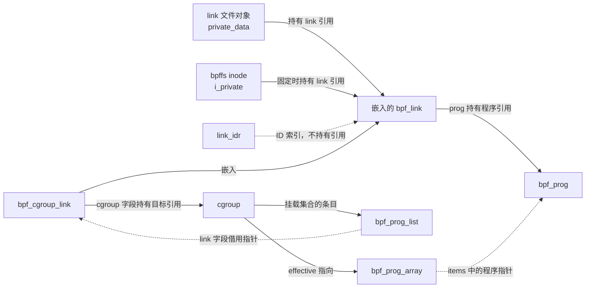
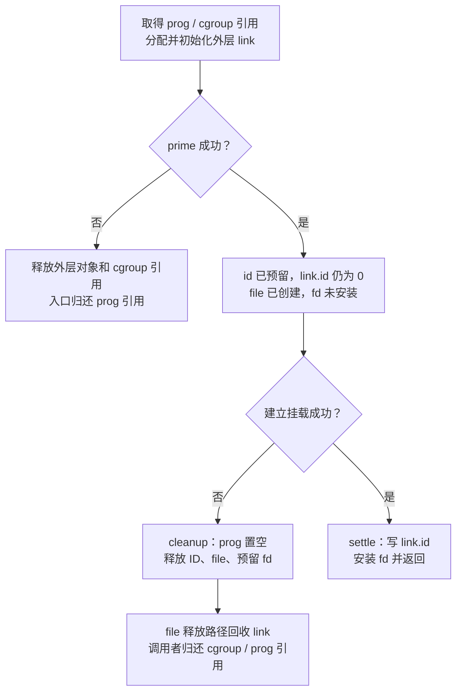
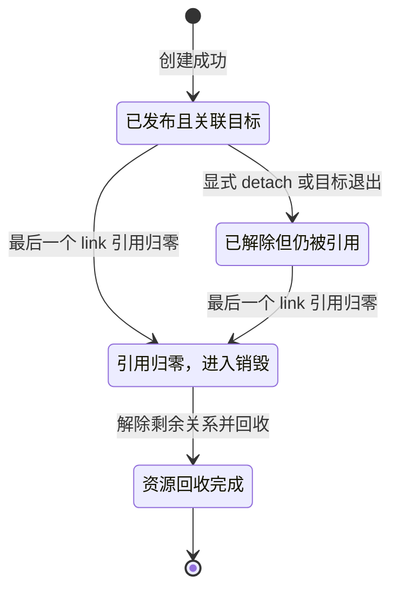

# BPF link：把挂载关系变成可管理的内核对象

给一个 cgroup 安装 BPF 网络策略后，有三个不同的问题：程序的指令还在不在，策略还挂在不在，以及谁有权继续管理这次挂载。只保存程序 fd，不能把这三个问题合在一起回答：程序对象表示代码，挂载关系还需要记录目标、挂载类型以及解除和替换的规则。

`bpf_link` 把**一次挂载关系及其管理生命周期**表示为内核对象。用户可以通过 link fd 操作它，也可以把它固定到 BPF 文件系统（bpffs）中。通用层负责引用、ID、文件接口和释放框架；挂载子系统负责把程序接到真正的事件入口，并定义替换和解除行为。依据见 [`struct bpf_link` 与操作表](../../linux/include/linux/bpf.h#L1747-L1793)、[link 文件接口](../../linux/kernel/bpf/syscall.c#L3393-L3410)和 [cgroup 操作表](../../linux/kernel/bpf/cgroup.c#L1524-L1531)。

读者需要了解 C 结构体嵌入、文件描述符、引用计数和 RCU 的基本作用。程序的加载、验证与执行入口见 [BPF prog](prog.md)，子系统整体关系见 [BPF 子系统概述](introduction.md)。本章以通用 link 框架为主，用普通 cgroup link 串起完整流程；raw tracepoint 用来说明延迟回收，struct_ops 用来说明框架边界。不展开每一种探针、网络挂载和 trampoline 的内部算法。

## 0. 分析基线与配置边界

本章源码为仓库内 **Linux 6.18.52**，架构选择 **x86-64**，依据是 [Makefile 第 2～4 行](../../linux/Makefile#L2-L4)和 [.config 第 332～334 行](../../linux/.config#L332-L334)。以下配置决定本章实际编译分支：

| 条件 | 本章影响 | 依据 |
| --- | --- | --- |
| `CONFIG_BPF=y`、`CONFIG_BPF_SYSCALL=y` | 编入 BPF 目录以及 `syscall.c`、`inode.c`，包含通用 link 管理和 bpffs | [.config](../../linux/.config#L117-L124)、[kernel/Makefile](../../linux/kernel/Makefile#L123)、[kernel/bpf/Makefile](../../linux/kernel/bpf/Makefile#L9-L10) |
| `CONFIG_CGROUP_BPF=y` | 编入本章的 cgroup link 实例；该选项依赖 `BPF_SYSCALL` | [.config](../../linux/.config#L233)、[init/Kconfig](../../linux/init/Kconfig#L1303-L1306)、[构建规则](../../linux/kernel/bpf/Makefile#L35) |
| `CONFIG_NET=y` | 支持作为主例子的网络事件场景；控制对象本身仍由 cgroup link 管理 | [.config](../../linux/.config#L1309)、[cgroup 网络执行入口](../../linux/kernel/bpf/cgroup.c#L1624-L1650) |
| `CONFIG_TRACING=y`、`CONFIG_BPF_EVENTS=y` | 编入 raw tracepoint 实例使用的探针注册实现 | [.config TRACING](../../linux/.config#L10734)、[.config BPF_EVENTS](../../linux/.config#L10768)、[kernel/trace/Kconfig](../../linux/kernel/trace/Kconfig#L810-L817)、[trace 目录构建](../../linux/kernel/Makefile#L115-L119)、[bpf_trace.o 构建](../../linux/kernel/trace/Makefile#L90) |
| `CONFIG_BPF_JIT=y`，结合 `CONFIG_BPF_SYSCALL=y` | 编入作为框架边界实例的 `bpf_struct_ops.c`；不代表 BTF 条件和具体类型注册一定成立 | [.config](../../linux/.config#L124-L125)、[构建规则](../../linux/kernel/bpf/Makefile#L42-L46) |
| `CONFIG_PREEMPT_RCU=y`、`CONFIG_TASKS_TRACE_RCU=y` | 支持普通 RCU 与 RCU Tasks Trace 回收；选择哪条路径仍取决于 link 类型和可睡眠属性 | [.config](../../linux/.config#L165-L175)、[link 回收分支](../../linux/kernel/bpf/syscall.c#L3270-L3293) |
| `CONFIG_PROC_FS=y` | 编入 link 的 `show_fdinfo` 接口 | [.config](../../linux/.config#L9724)、[条件编译与实现](../../linux/kernel/bpf/syscall.c#L3331-L3384) |

本配置 `CONFIG_PAHOLE_VERSION=0`，不满足 `DEBUG_INFO_BTF` 的依赖，不能把依赖 vmlinux BTF 的挂载路径当作当前构建必然可用的路径。`bpf_get_btf_vmlinux()` 只在 `CONFIG_DEBUG_INFO_BTF` 启用时尝试解析；加载时指定 `attach_btf_id`、回退到 vmlinux BTF 却未得到 BTF，返回 `-EINVAL`。本章的普通 cgroup 网络策略实例不依赖这一回退路径。[配置](../../linux/.config#L26) · [BTF 配置依赖](../../linux/lib/Kconfig.debug#L377-L385) · [vmlinux BTF 获取](../../linux/kernel/bpf/verifier.c#L24432-L24452) · [加载检查](../../linux/kernel/bpf/syscall.c#L2968-L2979)

静态分析可以确认编译支持和代码协议，不能证明某个 cgroup 已挂载程序、bpffs 已挂载，或某次事件确实执行了程序。

## 1. link 解决什么问题

### 1.1 程序与挂载关系需要分开管理

以 cgroup 入站网络策略为例：程序加载得到 prog fd；创建 link 时提交 prog fd、目标 cgroup fd 和挂载类型，成功得到 link fd。前一个句柄管理代码对象，后一个句柄管理这次挂载。创建入口取得一份程序引用，成功后由 link 接收；失败时入口归还引用。[`link_create()`](../../linux/kernel/bpf/syscall.c#L5694-L5723) · [失败时归还程序引用](../../linux/kernel/bpf/syscall.c#L5792-L5795)

因此，关闭原来的 prog fd 不会自行解除已成功建立的 cgroup link；link 仍持有程序引用。反过来，解除 link 的挂载也不等于立刻销毁程序：程序还可能被其他 link、文件或对象引用，且引用归零后还有延迟回收过程。[程序文件释放](../../linux/kernel/bpf/syscall.c#L2449-L2454) · [link 最终归还程序引用](../../linux/kernel/bpf/syscall.c#L3241-L3251) · [程序引用归零处理](../../linux/kernel/bpf/syscall.c#L2429-L2446)

| 对象或句柄 | 表示什么 | 不能据此推断什么 |
| --- | --- | --- |
| `bpf_prog` / prog fd | 可执行的程序对象及访问句柄 | 程序已经挂载到某个目标 |
| `bpf_link` / link fd | 一次挂载的管理对象及访问句柄 | 目标永远存在，或者该类型支持所有管理操作 |
| link ID | 全局 IDR 中的查询编号 | 它本身持有引用、保证对象存活 |
| bpffs 固定对象 | 文件系统 inode 持有的对象引用 | 固定 prog 与固定 link 具有相同效果 |

依据分别是 [创建分派](../../linux/kernel/bpf/syscall.c#L5694-L5795)、[ID 分配](../../linux/kernel/bpf/syscall.c#L3412-L3422)、[按 ID 取得引用](../../linux/kernel/bpf/syscall.c#L5914-L5933)以及 [bpffs 分别固定 prog、map、link](../../linux/kernel/bpf/inode.c#L460-L490)。

### 1.2 整体流程：控制路径与事件路径

下面的概览图只表达普通 cgroup link 的阶段推进。创建、管理和回收走控制路径；网络事件沿 cgroup 的有效程序数组执行，不经过 link 文件操作表。


创建顺序来自 [`cgroup_bpf_link_attach()`](../../linux/kernel/bpf/cgroup.c#L1540-L1582)，数组发布见 [`update_effective_progs()`](../../linux/kernel/bpf/cgroup.c#L591-L638)，执行见 [`bpf_prog_run_array_cg()`](../../linux/kernel/bpf/cgroup.c#L83-L115)。图中的“发布”有两个层次：挂载点开始使用程序，与用户取得 link 管理句柄，不是同一个动作。

## 2. 核心数据结构：公共头与挂载点私有状态

### 2.1 `bpf_link`：管理关系的公共头

`bpf_link` 没有指令数组，也没有通用的“执行 link”入口。它保存程序指针、管理状态和操作表；具体目标通常保存在外层类型结构中。[`struct bpf_link`](../../linux/include/linux/bpf.h#L1747-L1769) · [cgroup 外层结构](../../linux/include/linux/bpf-cgroup.h#L100-L103)

| 字段 | 含义与约束 | 生命周期或保护 |
| --- | --- | --- |
| `refcnt` | 64 位原子引用计数，初始化为 1 | 正常持有者可以增加；ID 查询只能在非零时增加，不能复活正在销毁的对象 |
| `id` | 全局查询编号；0 表示尚未完成对外发布 | 在 `link_idr_lock` 下发布、移除和查询；不等于 fd |
| `type` | link 实现类别，如 `BPF_LINK_TYPE_CGROUP` | 初始化时确定，用来区分对象类别 |
| `ops` | 类型的静态管理回调表 | 是操作表指针，不是另一份引用计数对象 |
| `prog` | 程序指针；普通程序 link 接收创建入口取得的引用 | 类型回调负责更新，最终由通用层归还；struct_ops map link 是例外 |
| `attach_type` | 具体挂载语义，例如 cgroup 入站或出站 | 与 link 类型、prog 类型是三种不同的分类 |
| `flags` | 类型使用的 link 标志存储 | 不应理解成自动复制的整份 `link_create.flags`；通用初始化函数没有赋值该字段 |
| `work` / `rcu` | 同一联合体中的工作项与 RCU 回调头 | 工作项可以先安排销毁，再使用 RCU 回调；不能同时使用两者 |
| `sleepable` | link 目标的存活保护是否需要可睡眠语义 | 可以不同于 `prog->sleepable`；影响延迟回收协议 |

字段依据见 [bpf.h 第 1747～1769 行](../../linux/include/linux/bpf.h#L1747-L1769)，初始化见 [syscall.c 第 3180～3206 行](../../linux/kernel/bpf/syscall.c#L3180-L3206)，非零增引用见 [`bpf_link_inc_not_zero()`](../../linux/kernel/bpf/syscall.c#L5908-L5911)。`link_create.flags` 由 cgroup 入口单独验证并传给挂载算法，见 [cgroup.c 第 1547～1572 行](../../linux/kernel/bpf/cgroup.c#L1547-L1572)。

一个容易遗漏的契约是：**`bpf_link_init()` 不增加程序引用**。它只是把传入的 `prog` 保存下来。分析某种 link 时，需要沿创建调用者确认引用从何处取得、成功后交给谁、失败时谁归还。[初始化赋值](../../linux/kernel/bpf/syscall.c#L3188-L3206) · [从 fd 取得程序引用](../../linux/kernel/bpf/syscall.c#L2608-L2629) · [创建成功和失败的归属](../../linux/kernel/bpf/syscall.c#L5705-L5712)及 [out 分支](../../linux/kernel/bpf/syscall.c#L5792-L5795)

### 2.2 `bpf_link_ops`：统一框架中的类型契约

通用层不能知道如何从 cgroup 链表删除条目，也不能知道如何注销 tracepoint 探针，因此把这些操作交给类型回调。[操作表定义](../../linux/include/linux/bpf.h#L1771-L1793)

| 回调 | 解决的问题 | 通用层的处理 |
| --- | --- | --- |
| `release` | 撤销挂载及相关资源 | 最终销毁时，仅当 `link->prog` 非空才调用 |
| `dealloc` | 释放外层对象 | 通用框架不先等待 link 的 RCU 宽限期；类型必须满足自身安全条件 |
| `dealloc_deferred` | 等待读者后释放外层对象 | 先安排 RCU 回调，再归还程序引用并调用该回调 |
| `detach` | 在 link 仍被持有时显式解除 | 不支持时 `BPF_LINK_DETACH` 返回 `-EOPNOTSUPP` |
| `update_prog` | 替换程序，支持可选的旧对象比较 | 成功接收 `new_prog` 引用，失败由入口归还；缺少回调返回 `-EINVAL` |
| `update_map` | 替换 map，例如 struct_ops map link | 优先于 `update_prog` 分支，引用契约与程序更新不同 |
| `show_fdinfo` / `fill_link_info` | 输出类型私有信息 | 通用层先提供公共信息，再调用类型回调 |
| `poll` | 提供等待/通知能力 | 决定创建时使用带 `poll` 的另一套文件操作表 |

调用协议见 [最终释放](../../linux/kernel/bpf/syscall.c#L3241-L3293)、[更新](../../linux/kernel/bpf/syscall.c#L5798-L5882)、[显式解除](../../linux/kernel/bpf/syscall.c#L5887-L5905)、[fdinfo](../../linux/kernel/bpf/syscall.c#L3343-L3382)、[信息查询](../../linux/kernel/bpf/syscall.c#L5396-L5409)和 [文件操作表选择](../../linux/kernel/bpf/syscall.c#L3454-L3456)。初始化用 `WARN_ON` 检查 `dealloc` 与 `dealloc_deferred` 不应同时提供。[初始化检查](../../linux/kernel/bpf/syscall.c#L3192)

### 2.3 cgroup link：对象嵌入与集合成员

外层 `bpf_cgroup_link` 直接嵌入公共头，并保存目标 `cgroup` 指针；`bpf_prog_list` 是 cgroup 挂载集合中的单独条目，保存直接程序或者 link。通过 link 挂载时，`pl->prog=NULL`、`pl->link=link`，程序从 `pl->link->link.prog` 取得。[两个结构定义](../../linux/include/linux/bpf-cgroup.h#L100-L111) · [挂载条目赋值](../../linux/kernel/bpf/cgroup.c#L887-L889) · [`prog_list_prog()`](../../linux/kernel/bpf/cgroup.c#L390-L399)

下图只画一条普通 cgroup link。虚线表示查询索引或借用指针，实线文字说明嵌入与持有引用，不能把所有指针当作所有权。



文件与固定引用依据见 [文件释放](../../linux/kernel/bpf/syscall.c#L3323-L3328)、[bpffs 取得引用](../../linux/kernel/bpf/inode.c#L71-L90)和 [inode 保存对象](../../linux/kernel/bpf/inode.c#L331-L343)。目标引用来自 [cgroup fd 获取及保存](../../linux/kernel/bpf/cgroup.c#L1550-L1561)，集合关系见 [条目赋值](../../linux/kernel/bpf/cgroup.c#L887-L900)，有效数组只复制程序指针，见 [数组填充](../../linux/kernel/bpf/cgroup.c#L484-L498)。

cgroup 挂载路径没有给 `pl->link` 增加 link 引用；否则单靠关闭管理句柄就无法触发最终解除。这里的安全协议是：管理对象存活时条目借用它；最后引用归零时，类型的 `release` 先在 `cgroup_mutex` 下移除条目，再释放外层对象。cgroup 自身退出也在同一锁下移除条目并清空目标指针。[建立条目](../../linux/kernel/bpf/cgroup.c#L868-L913) · [link 释放](../../linux/kernel/bpf/cgroup.c#L1440-L1478) · [cgroup 退出清理](../../linux/kernel/bpf/cgroup.c#L335-L360)

### 2.4 `bpf_link_primer`：创建过程中尚未提交的资源

`bpf_link_primer` 保存 `link`、`file`、预留的 `fd` 和分配的 `id`。它是创建函数栈上的临时状态，不是长期挂载对象。单独保存 ID 的原因是：预留 ID 已进入 IDR，而 link 自身的 `id` 仍为 0，尚不能通过用户的按 ID 查询获得引用。[结构定义](../../linux/include/linux/bpf.h#L1818-L1823) · [cgroup 创建中的局部变量](../../linux/kernel/bpf/cgroup.c#L1540-L1545) · [prime 填写](../../linux/kernel/bpf/syscall.c#L3463-L3467) · [按 ID 查询的发布检查](../../linux/kernel/bpf/syscall.c#L5921-L5932)

## 3. 创建算法：先准备资源，再建立关系，最后发布句柄

### 3.1 系统调用入口与输入

`__sys_bpf()` 检查未知尾部是否为零，清零并复制 `union bpf_attr`，经过 `security_bpf()` 后将 `BPF_LINK_CREATE` 分派到 `link_create()`。后者检查本命令不用的属性字段，获取程序引用并校验挂载类型，再交给具体子系统。[系统调用入口](../../linux/kernel/bpf/syscall.c#L6160-L6177) · [命令分派](../../linux/kernel/bpf/syscall.c#L6268-L6270) · [link 创建入口](../../linux/kernel/bpf/syscall.c#L5693-L5723)

普通 cgroup link 的输入如下：

| 属性 | 语义 |
| --- | --- |
| `link_create.prog_fd` | 已加载的程序 fd；传入的不是指令数组 |
| `link_create.target_fd` | 目标 cgroup 的 fd；其他 link 类型可能使用不同目标表示 |
| `link_create.attach_type` | 例如 `BPF_CGROUP_INET_INGRESS`，决定具体事件语义 |
| `link_create.flags` | cgroup link 接受的排序和锚点标志；入口内部加上 `BPF_F_ALLOW_MULTI` |
| `link_create.cgroup.relative_fd` / `relative_id` | 配合相关标志指定排序锚点，fd 与 ID 共用 UAPI 存储位置 |
| `link_create.cgroup.expected_revision` | 非零时要求挂载集合修订号匹配，不匹配返回 `-ESTALE` |

UAPI 定义见 [公共字段](../../linux/include/uapi/linux/bpf.h#L1762-L1774)与 [cgroup 特有字段](../../linux/include/uapi/linux/bpf.h#L1831-L1839)，标志掩码和参数传递见 [cgroup.c 第 1533～1572 行](../../linux/kernel/bpf/cgroup.c#L1533-L1572)，修订号检查见 [cgroup.c 第 838～842 行](../../linux/kernel/bpf/cgroup.c#L838-L842)。不指定排序锚点、使用零修订号即可理解基本主线。

挂载类型校验包含类型相关权限检查。例如 `CGROUP_SKB` 在挂载时检查 `CAP_NET_ADMIN`，并按程序的 `enforce_expected_attach_type` 决定是否要求预期类型相等。因此不能简单说“拥有 prog fd 就一定能挂载”。[`bpf_prog_attach_check_attach_type()`](../../linux/kernel/bpf/syscall.c#L4398-L4422)

### 3.2 初始化与预留：此时还没有可访问的 link fd

`cgroup_bpf_link_attach()` 从目标 fd 取得 cgroup 引用，分配外层对象，初始化公共头并保存目标。此时 `refcnt=1`、`id=0`，程序引用仍处于“成功则交给 link，失败则由调用者归还”的创建协议中。[cgroup 初始化](../../linux/kernel/bpf/cgroup.c#L1550-L1561) · [公共初始化](../../linux/kernel/bpf/syscall.c#L3188-L3206)

`bpf_link_prime()` 按顺序完成三件事：预留带 `O_CLOEXEC` 的 fd、分配全局 ID、创建匿名 inode 文件，把 link 放到文件的 `private_data`。任何一步失败，都回收已预留的资源；成功后把资源记到 primer。它没有调用 `fd_install()`，也没有把预留 ID 写入 `link->id`。[`bpf_link_prime()`](../../linux/kernel/bpf/syscall.c#L3438-L3467)

ID 分配先 `idr_preload(GFP_KERNEL)`，再在 `spin_lock_bh(&link_idr_lock)` 内以 `GFP_ATOMIC` 分配，使用 `idr_alloc_cyclic()`，范围从 1 起、以 `INT_MAX` 为不含端点的上界。编号可能被循环复用，不能把 ID 当作永久标识。[`bpf_link_alloc_id()`](../../linux/kernel/bpf/syscall.c#L3412-L3422) · [IDR 循环分配及端点语义](../../linux/lib/idr.c#L98-L137)

为什么先预留？源码注释明确说明：先把可能失败的 fd、file、ID 分配做完，可以避免在复杂、昂贵的实际挂载之后，仅因句柄资源分配失败而进行回滚。这是创建框架直接声明的取舍。[prime 的设计说明](../../linux/kernel/bpf/syscall.c#L3425-L3436)

### 3.3 建立 cgroup 挂载与发布

预留成功后才调用 `cgroup_bpf_attach()`。包装层持有 `cgroup_mutex`，内部检查层级允许的挂载模式、已有集合标志和数量上限，创建条目，把 link 加入目标挂载集合，并更新目标及后代的有效程序数组。数组准备失败时撤销本次条目和相关分配。[锁包装](../../linux/kernel/bpf/cgroup.c#L935-L947) · [检查与条目建立](../../linux/kernel/bpf/cgroup.c#L838-L900) · [失败回滚](../../linux/kernel/bpf/cgroup.c#L915-L932)

数组更新也分为准备与发布：先为尚有 BPF 生命周期引用的目标及后代计算 `inactive` 数组，全部分配成功后逐个激活；失败则释放尚未激活的数组。激活用 `rcu_replace_pointer()` 替换 `effective[atype]`，旧数组通过 `bpf_prog_array_free()` 延迟释放。[批量准备和激活](../../linux/kernel/bpf/cgroup.c#L591-L638) · [RCU 指针发布](../../linux/kernel/bpf/cgroup.c#L511-L520) · [数组延迟释放](../../linux/kernel/bpf/core.c#L2649-L2654)

挂载完成后，`bpf_link_settle()` 才发布用户管理接口：

```c
int bpf_link_settle(struct bpf_link_primer *primer)
{
	/* make bpf_link fetchable by ID */
	spin_lock_bh(&link_idr_lock);
	primer->link->id = primer->id;
	spin_unlock_bh(&link_idr_lock);
	/* make bpf_link fetchable by FD */
	fd_install(primer->fd, primer->file);
	/* pass through installed FD */
	return primer->fd;
}
```

来源：[`bpf_link_settle()`，syscall.c 第 3470～3480 行](../../linux/kernel/bpf/syscall.c#L3470-L3480)。先使 ID 可查询，再安装 fd；这两项不是一次跨接口的原子操作。挂载点程序也可能在 `settle()` 前已经进入事件可见的数组，所以“系统调用尚未返回”不等于“程序尚不能执行”。[cgroup 创建顺序](../../linux/kernel/bpf/cgroup.c#L1569-L1578)

下图集中说明创建状态与失败出口，箭头表示创建算法的推进，省略 cgroup 数组算法内部步骤。



图的依据是 [cgroup 创建和错误出口](../../linux/kernel/bpf/cgroup.c#L1540-L1582)、[通用 cleanup](../../linux/kernel/bpf/syscall.c#L3219-L3234)与 [创建入口的程序引用处理](../../linux/kernel/bpf/syscall.c#L5792-L5795)。已创建 file 后的失败清理为什么不能直接 `kfree()`，将在第 5 节展开。

## 4. 挂载之后：执行与程序替换

### 4.1 link 是管理对象，事件执行使用有效数组

cgroup 同时维护本级挂载集合和考虑层级继承后的 `effective[atype]` 数组。计算数组时通过 `prog_list_prog()` 把直接程序与 link 程序统一转换成程序指针，按层级和标志形成执行集合。[程序解析](../../linux/kernel/bpf/cgroup.c#L390-L399) · [`compute_effective_progs()`](../../linux/kernel/bpf/cgroup.c#L447-L508)

网络事件以 `__cgroup_bpf_run_filter_skb()` 为例，先从 socket 取得 cgroup，准备 skb 上下文，再调用数组执行函数。后者在 `rcu_read_lock_dont_migrate()` 保护下读取数组，用 `READ_ONCE(item->prog)` 读取每个程序指针，再调用传入的执行包装函数；事件路径不取得 `cgroup_mutex`，也不通过 link fd 查找程序。[skb 入口](../../linux/kernel/bpf/cgroup.c#L1624-L1650) · [数组读侧与执行](../../linux/kernel/bpf/cgroup.c#L83-L115)

这解释了为什么管理锁和 RCU 需要配合：互斥锁串行化挂载集合的修改，RCU 与程序延迟回收保证并发事件拿到的旧数组、旧程序暂时仍有效。控制路径可以分配和睡眠，程序运行则继承事件入口的执行上下文；link 本身没有统一的运行线程。[`cgroup_lock()`](../../linux/include/linux/cgroup.h#L389-L399) · [数组替换与回收](../../linux/kernel/bpf/cgroup.c#L511-L520) · [程序释放的 RCU 分支](../../linux/kernel/bpf/syscall.c#L2406-L2413)

### 4.2 `BPF_LINK_UPDATE`：用旧对象检查防止覆盖别人的更新

程序更新的输入是 `link_fd`、`new_prog_fd`，以及可选的 `BPF_F_REPLACE` 和 `old_prog_fd`。这里的旧程序是“我预期 link 当前关联的对象”，不是要求内核重新加载旧代码。没有 `BPF_F_REPLACE` 却填写旧 fd，返回 `-EINVAL`。[UAPI 更新字段](../../linux/include/uapi/linux/bpf.h#L1841-L1860) · [标志与旧 fd 检查](../../linux/kernel/bpf/syscall.c#L5839-L5868)

通用入口先给 link 增加临时引用，再给新程序和可选旧程序增加引用，调用 `update_prog`。无论结果如何都归还旧程序的临时引用；新程序在失败时归还，成功则交给类型实现；最后归还 link 的临时引用。[`link_update()`](../../linux/kernel/bpf/syscall.c#L5843-L5882)

cgroup 的比较与替换在 `cgroup_mutex` 下执行，步骤是：

1. 检查目标是否仍关联；`cg_link->cgroup=NULL` 时返回 `-ENOLINK`。
2. 如果指定了旧程序，比较内核对象指针；与当前 `link->prog` 不同返回 `-EPERM`。fd 数值相等与否不是比较依据。
3. 定位挂载类别和对应集合条目，检查新旧程序类型以及 cgroup storage map 指针是否兼容。
4. 增加目标集合修订号，用 `xchg()` 替换 `link->prog`，更新后代有效数组对应槽位，归还旧程序原来由 link 持有的引用。

比较锁协议见 [`cgroup_bpf_replace()`](../../linux/kernel/bpf/cgroup.c#L1091-L1112)，兼容条件见 [`cgroup_bpf_storages_compatible()`](../../linux/kernel/bpf/cgroup.c#L1029-L1040)，状态变化见 [`__cgroup_bpf_replace()`](../../linux/kernel/bpf/cgroup.c#L1053-L1088)。

例如两个管理进程都认为 link 关联程序 A：第一个以 `BPF_F_REPLACE` 提交 A→B，第二个提交 A→C。第一个成功后，第二个在锁内看到当前对象为 B，返回 `-EPERM`，避免覆盖已经发生的更新。这是根据上述指针比较协议推导的并发场景。

### 4.3 替换没有重新建立 link，也不是全局同时切换

cgroup 替换程序保持原 link 对象、ID 和目标不变。`replace_effective_prog()` 遍历后代，重新定位该挂载条目在有效数组中的位置，并用 `WRITE_ONCE(item->prog, ...)` 更新槽位，不为本次替换重新分配整批数组。正常状态不变量下，这一步被实现定义为保证成功。[`replace_effective_prog()`](../../linux/kernel/bpf/cgroup.c#L999-L1027) · [替换调用点](../../linux/kernel/bpf/cgroup.c#L1084-L1088)

下面只摘录提交阶段原始源码；前置检查见上一节引用。

```c
	cgrp->bpf.revisions[atype] += 1;
	old_prog = xchg(&link->link.prog, new_prog);
	replace_effective_prog(cgrp, atype, pl);
	bpf_prog_put(old_prog);
	return 0;
```

来源：[cgroup.c 第 1084～1088 行](../../linux/kernel/bpf/cgroup.c#L1084-L1088)。读侧可能已经取得旧指针，旧程序的最终释放由程序引用与 RCU 协议保证安全；更新后代数组逐个进行，不能说所有 CPU、所有后代在同一瞬间全部切换到新程序。[读侧取指针](../../linux/kernel/bpf/cgroup.c#L97-L114) · [逐个更新](../../linux/kernel/bpf/cgroup.c#L1011-L1025) · [程序延迟回收](../../linux/kernel/bpf/syscall.c#L2394-L2440)

## 5. 生命周期：解除挂载、引用归零和安全回收

### 5.1 显式 detach 保留管理对象

`BPF_LINK_DETACH` 从 fd 取得 link 临时引用，调用类型的 `detach`，再归还该临时引用。它不会替用户关闭 fd；没有 `detach` 回调则返回 `-EOPNOTSUPP`。[`link_detach()`](../../linux/kernel/bpf/syscall.c#L5887-L5905)

cgroup 的 `detach` 调用 `bpf_cgroup_link_release()` 并返回 0。release 在锁外先检查目标是否为空，取得 `cgroup_mutex` 后再次检查，防止与 cgroup 自动退出竞争；随后移除挂载条目、更新有效数组，把 `cg_link->cgroup` 清为 NULL，解锁后归还目标引用。再次 detach 已解除的对象会直接返回成功。[cgroup detach](../../linux/kernel/bpf/cgroup.c#L1481-L1485) · [release 的双重检查和清理](../../linux/kernel/bpf/cgroup.c#L1440-L1470)

这里没有把 `link->prog` 清空，也没有归还 link 持有的程序引用。只要 link 仍被文件或固定对象引用，它还保留原程序；更新因目标为空返回 `-ENOLINK`，信息查询的 cgroup ID 则为 0。[解除时只清空目标](../../linux/kernel/bpf/cgroup.c#L1460-L1470) · [更新检查](../../linux/kernel/bpf/cgroup.c#L1099-L1107) · [信息填写](../../linux/kernel/bpf/cgroup.c#L1507-L1521)

### 5.2 解除时分配失败，仍需让程序退出执行集合

`__cgroup_bpf_detach()` 先把条目的 `prog` 和 `link` 暂时置空，让重算有效数组忽略它。如果新数组分配失败，恢复条目指针供定位使用，再通过 `purge_effective_progs()` 原地删除有效数组中的对应程序，最后移除并释放集合条目。[detach 主体](../../linux/kernel/bpf/cgroup.c#L1231-L1257) · [原地清理](../../linux/kernel/bpf/cgroup.c#L1156-L1182)

所谓原地删除实际是用返回 1 的 dummy 程序覆盖槽位，通过 `WRITE_ONCE` 修改程序指针。这样无需因为内存不足而让应解除的程序继续参与执行，也不必缩短正在被并发遍历的数组。这是由该失败分支和数组实现可直接推导的作用。[dummy 定义](../../linux/kernel/bpf/core.c#L2618-L2630) · [dummy 替换](../../linux/kernel/bpf/core.c#L2756-L2774) · [槽位更新](../../linux/kernel/bpf/core.c#L2791-L2804)

### 5.3 目标退出：对象仍在，关系已经失效

cgroup 的 BPF 退出清理由工作队列执行，在 `cgroup_mutex` 下删除各挂载条目、释放有效数组。对 link 条目调用 `bpf_cgroup_link_auto_detach()`，它只归还 cgroup 引用并将 `link->cgroup=NULL`；link 本体及其程序引用仍由 link 管理生命周期负责。[释放工作调度](../../linux/kernel/bpf/cgroup.c#L378-L387) · [目标清理](../../linux/kernel/bpf/cgroup.c#L325-L360) · [自动解除函数体](../../linux/kernel/bpf/cgroup.c#L314-L318)

此处源码注释需要与实现区分：第 309～312 行写着自动解除会归还 cgroup 和程序引用，但紧接着的函数体只执行 `cgroup_put()` 和目标清空。调用者对 link 分支也没有 `bpf_prog_put()`；程序引用由通用 `bpf_link_dealloc()` 最终归还。本章按实际函数体解释，不能沿用该注释得出“自动解除立即释放程序”的结论。[注释及函数体](../../linux/kernel/bpf/cgroup.c#L309-L318) · [调用者的两个分支](../../linux/kernel/bpf/cgroup.c#L342-L353) · [最终归还程序](../../linux/kernel/bpf/syscall.c#L3241-L3251)

用普通 cgroup link 的简化状态图，可以把“有对象”与“仍有挂载”分开。这里未画创建失败状态和各类 RCU 回收分支。



状态转换依据见 [cgroup 解除](../../linux/kernel/bpf/cgroup.c#L1440-L1485)、[目标自动解除](../../linux/kernel/bpf/cgroup.c#L314-L318)和 [引用归零后的通用释放](../../linux/kernel/bpf/syscall.c#L3270-L3328)。已解除对象仍能查询，但本章的 cgroup 实现没有将其重新关联到另一个目标的更新操作。

### 5.4 最后引用归零：先断开入口，再归还程序和内存

`bpf_link_put()` 可以被原子上下文调用，所以引用归零后总是安排工作项，由工作队列进入保证处于进程上下文的 `bpf_link_free()`。文件释放和系统调用管理入口使用内部的 `bpf_link_put_direct()`，可以直接进入 free。两者的区别是安排释放的上下文，不是不同的引用类型。[两种 put](../../linux/kernel/bpf/syscall.c#L3296-L3328)

通用 free 的顺序是：

1. 从 `link_idr` 移除 ID，使后续 ID 查询不能再得到对象。
2. `link->prog` 非空时调用 `ops->release()`，撤销挂载。
3. 按类型选择直接 dealloc 或安排 RCU 回调。
4. 到达 `bpf_link_dealloc()` 后归还 `link->prog` 引用，再调用类型回调释放外层内存。

依据见 [ID 移除](../../linux/kernel/bpf/syscall.c#L3209-L3216)、[`bpf_link_free()`](../../linux/kernel/bpf/syscall.c#L3269-L3293)与 [`bpf_link_dealloc()`](../../linux/kernel/bpf/syscall.c#L3241-L3251)。引用归零与 ID 真正移除之间可能有短暂间隔，但按 ID 取得引用必须调用 `bpf_link_inc_not_zero()`，不会把 0 增回 1。[ID 查找协议](../../linux/kernel/bpf/syscall.c#L5908-L5933)

普通 cgroup link 提供 `dealloc`，外层对象在关系移除后直接 `kfree()`；事件数组保存的是程序指针，旧程序和旧数组各自走回收协议。这不等于“所有 BPF 资源都同步释放”。[cgroup 操作表和 dealloc](../../linux/kernel/bpf/cgroup.c#L1473-L1478)及 [操作表](../../linux/kernel/bpf/cgroup.c#L1524-L1531) · [程序回收](../../linux/kernel/bpf/syscall.c#L2406-L2440)

### 5.5 延迟释放：link 与程序可睡眠属性要分别判断

raw tracepoint 注册把外层 link 作为探针数据交给 tracepoint；注销在 `release` 中完成，但外层对象使用 `dealloc_deferred` 回收。创建时 `link->sleepable` 取自目标 tracepoint 的 `tracepoint_is_faultable()`，不能只看程序的可睡眠属性。[注册的探针数据](../../linux/kernel/trace/bpf_trace.c#L2128-L2148) · [注销探针](../../linux/kernel/bpf/syscall.c#L3786-L3800) · [延迟回调表](../../linux/kernel/bpf/syscall.c#L3857-L3862) · [目标属性初始化](../../linux/kernel/bpf/syscall.c#L4276-L4278)

| 类型回收选择 | 通用等待协议 |
| --- | --- |
| 提供 `dealloc` | 通用层不先等待 link 的 RCU 宽限期，直接调用 dealloc 路径 |
| 提供 `dealloc_deferred`，link 和程序都不要求可睡眠保护 | `call_rcu()` 后归还程序引用并回收对象 |
| 提供 `dealloc_deferred`，`link->sleepable` 或 `prog->sleepable` 为真 | 先 `call_rcu_tasks_trace()`；回调再判断是否需要额外普通 RCU 宽限期 |

具体分支见 [syscall.c 第 3278～3293 行](../../linux/kernel/bpf/syscall.c#L3278-L3293)。本版本 `rcu_trace_implies_rcu_gp()` 恒返回 true，所以 Tasks Trace 回调直接进入 dealloc，不再另外安排 `call_rcu()`。操作表注释虽然描述了两类宽限期的串接要求，实际代码会利用当前实现的蕴含关系。[回调选择](../../linux/kernel/bpf/syscall.c#L3261-L3266) · [当前蕴含判断](../../linux/include/linux/rcupdate.h#L227-L237)

需要等待的并不只是 link 内存：挂载点可能经由 link 继续访问程序，因此通用层把 `bpf_prog_put()` 也推迟到上述等待完成之后。[初始化说明](../../linux/kernel/bpf/syscall.c#L3180-L3186) · [等待后归还程序](../../linux/kernel/bpf/syscall.c#L3241-L3251)

### 5.6 创建失败的 cleanup 为什么把 `prog` 清空

prime 成功后，匿名 inode 文件已经持有 link。即使 fd 尚未安装，`fput()` 仍会通过文件释放回调归还 link 引用，因此错误路径不能既直接 `kfree(link)`，又让文件随后释放它。[cleanup 契约说明](../../linux/kernel/bpf/syscall.c#L3219-L3226) · [文件释放回调](../../linux/kernel/bpf/syscall.c#L3323-L3328)

```c
void bpf_link_cleanup(struct bpf_link_primer *primer)
{
	primer->link->prog = NULL;
	bpf_link_free_id(primer->id);
	fput(primer->file);
	put_unused_fd(primer->fd);
}
```

来源：[syscall.c 第 3228～3234 行](../../linux/kernel/bpf/syscall.c#L3228-L3234)。`prog=NULL` 让通用 free 跳过类型 `release`，也跳过程序 put；调用者负责归还程序以及目标引用，文件释放路径最终回收 link 内存。因而 cleanup 是“失败构造对象的清理”，不是显式 detach。[free 的非空判断](../../linux/kernel/bpf/syscall.c#L3274-L3277) · [dealloc 的非空判断](../../linux/kernel/bpf/syscall.c#L3243-L3251) · [cgroup 错误出口](../../linux/kernel/bpf/cgroup.c#L1573-L1582) · [程序引用错误出口](../../linux/kernel/bpf/syscall.c#L5792-L5795)

## 6. 文件、固定与查询：谁维持对象存活

### 6.1 fd 数量不等于 link 引用计数

link fd 对应匿名 inode 文件，该文件的 `private_data` 指向 link，文件的最终 release 才归还这份 link 引用。`bpf_link_get_from_fd()` 检查文件操作表，随后额外增加一次临时 link 引用，供更新、解除等操作使用。[文件操作表](../../linux/kernel/bpf/syscall.c#L3393-L3410) · [文件最终 release](../../linux/kernel/bpf/syscall.c#L3323-L3328) · [fd 取 link](../../linux/kernel/bpf/syscall.c#L3489-L3501)

`dup()` 给新 fd 安装同一个 `struct file`，不会在每次复制 fd 时直接增加 `link->refcnt`。通过 `BPF_LINK_GET_FD_BY_ID` 或 `BPF_OBJ_GET` 则会先取得新的 link 引用，再创建新的匿名 inode 文件。因此讨论“关闭最后一个 fd”时，必须把共享文件、多个独立文件、固定引用和临时引用都考虑进去。[`dup()`](../../linux/fs/file.c#L1457-L1469) · [ID 获取新文件](../../linux/kernel/bpf/syscall.c#L5969-L5975) · [bpffs 获取新文件](../../linux/kernel/bpf/inode.c#L538-L552)

### 6.2 固定 link：把一份引用交给 bpffs inode

`BPF_OBJ_PIN` 的对象探测先尝试 map 和 prog，再尝试 link；取得 link 时已经增加引用。固定成功后，inode 的 `i_private` 保存对象，这份引用留给 inode；固定失败则立即归还。inode 销毁调用 `bpf_any_put()`，link 分支进入可用于异步回收的 `bpf_link_put()`。[探测并增引用](../../linux/kernel/bpf/inode.c#L71-L90) · [pin 成败协议](../../linux/kernel/bpf/inode.c#L478-L492) · [inode 保存](../../linux/kernel/bpf/inode.c#L331-L343) · [inode 销毁](../../linux/kernel/bpf/inode.c#L778-L784) · [link put 分支](../../linux/kernel/bpf/inode.c#L53-L64)

固定后即使创建进程关闭所有 link fd，inode 的引用仍维持对象存活；以后 `BPF_OBJ_GET` 从 inode 增引用，并创建新的 link 文件。该入口要求 link 的访问标志转换结果为 `O_RDWR`，否则返回 `-EINVAL`。[固定引用保留](../../linux/kernel/bpf/inode.c#L484-L490) · [从 inode 增引用](../../linux/kernel/bpf/inode.c#L495-L521) · [link 获取的标志限制](../../linux/kernel/bpf/inode.c#L527-L553)

固定 prog 只延长代码对象生命周期；固定 link 延长挂载管理对象生命周期。对仍关联目标的普通 cgroup link，后者能够维持这次挂载；但目标退出时依然会自动解除。固定操作不赋予目标“永不退出”的保证。[分别固定不同对象](../../linux/kernel/bpf/inode.c#L460-L469) · [cgroup 自动解除](../../linux/kernel/bpf/cgroup.c#L342-L353)

### 6.3 IDR 是查找表，不是持有者

`bpf_link_by_id()` 在 `link_idr_lock` 下查找并取得非零引用：找不到或引用已归零返回 `-ENOENT`；找到尚未 settle、`link->id=0` 的对象返回 `-EAGAIN`。全局 IDR 不增加引用，因此单纯记录 ID 不会让对象继续存活。[ID 分配](../../linux/kernel/bpf/syscall.c#L3412-L3422) · [查询与非零增引用](../../linux/kernel/bpf/syscall.c#L5908-L5933)

本版本的用户 `BPF_LINK_GET_NEXT_ID` 使用通用 `bpf_obj_get_next_id()`，只在锁内枚举 IDR，没有检查 `link->id` 是否为 0，也没有取得对象引用。因此枚举结果可能包含创建中的预留 ID；随后按 ID 获取 fd 可能遇到 `-EAGAIN`，也可能因并发销毁遇到 `-ENOENT`。枚举与取 fd 不是一个持有对象的事务。[枚举分派](../../linux/kernel/bpf/syscall.c#L6277-L6280) · [通用枚举实现](../../linux/kernel/bpf/syscall.c#L4736-L4759) · [按 ID 查找检查](../../linux/kernel/bpf/syscall.c#L5921-L5932)

`BPF_LINK_GET_FD_BY_ID` 要求 `CAP_SYS_ADMIN`，取得引用后创建新文件；创建文件失败时归还引用。上述用户 ID 枚举接口也要求 `CAP_SYS_ADMIN`。[按 ID 获取 fd](../../linux/kernel/bpf/syscall.c#L5957-L5977) · [枚举权限](../../linux/kernel/bpf/syscall.c#L4744-L4748)

### 6.4 查询结果是管理信息，不是运行日志

`BPF_OBJ_GET_INFO_BY_FD` 按文件操作表识别 link，然后填写 `bpf_link_info`：公共字段有 `type`、`id`、`prog_id`，cgroup 私有字段有 `cgroup_id` 与 `attach_type`。通用层在 RCU 读侧读取 `link->prog`，类型回调在自己的锁协议下读取目标信息。[fd 查询分派](../../linux/kernel/bpf/syscall.c#L5436-L5460) · [UAPI 信息结构](../../linux/include/uapi/linux/bpf.h#L6700-L6721) · [公共信息读取](../../linux/kernel/bpf/syscall.c#L5376-L5415) · [cgroup 信息读取](../../linux/kernel/bpf/cgroup.c#L1507-L1521)

`/proc/<pid>/fdinfo/<fd>` 也先输出公共 link 信息，再调用类型 `show_fdinfo`。这些结果可以表明查询时关联的程序和目标，不证明程序已经运行过；公共字段与私有字段分开读取，也不能当作与并发更新、detach 严格同步的一致快照。[fdinfo 实现](../../linux/kernel/bpf/syscall.c#L3343-L3382) · [cgroup fdinfo](../../linux/kernel/bpf/cgroup.c#L1488-L1504)

## 7. 框架边界：统一管理接口不等于统一挂载语义

### 7.1 创建分派跨多个子系统

`link_create()` 按程序类型将请求分派到 cgroup、tracing、网络命名空间、sockmap、XDP、TCX/netkit、netfilter、perf 和多探针入口。`target_fd`、`target_ifindex`、BTF ID、cookie 等字段由各类型解释，不能把 cgroup 的目标字段、锁和生命周期规则套到所有 link。[创建分派](../../linux/kernel/bpf/syscall.c#L5714-L5787) · [创建属性的联合体](../../linux/include/uapi/linux/bpf.h#L1762-L1792)

link 类型枚举也不是程序类型枚举。例如 `BPF_PROG_TYPE_SCHED_CLS` 可以按 attach type 进入 TCX 或 netkit；程序类型描述代码的接口，link 类型描述挂载对象的实现类别，attach type 描述具体挂载语义。[link 类别枚举](../../linux/include/uapi/linux/bpf.h#L1144-L1161) · [SCHED_CLS 分派](../../linux/kernel/bpf/syscall.c#L5763-L5769)

并非所有 link 都经由 `BPF_LINK_CREATE` 创建。普通 raw tracepoint 程序可以通过 `BPF_RAW_TRACEPOINT_OPEN` 进入 `bpf_raw_tp_link_attach()`，最终同样返回 link fd；其操作表没有 `detach` 或 `update_prog`，所以不能据“它是 link”推断它支持这些操作。[raw tracepoint 入口](../../linux/kernel/bpf/syscall.c#L4303-L4322) · [创建与返回 link fd](../../linux/kernel/bpf/syscall.c#L4256-L4298) · [操作表](../../linux/kernel/bpf/syscall.c#L3857-L3862)

### 7.2 struct_ops map link：`prog` 可以为空

`link_create()` 遇到 `BPF_STRUCT_OPS` 时，在获取 prog 之前直接进入 struct_ops 创建路径。该路径使用 `map_fd`，初始化 `link->prog=NULL`，外层 `bpf_struct_ops_link` 保存 RCU map 指针以及等待队列。注册成功后 link 接收取得的 map 引用，最终由类型 dealloc 注销注册并归还 map。[特殊分派](../../linux/kernel/bpf/syscall.c#L5702-L5707) · [外层结构](../../linux/kernel/bpf/bpf_struct_ops.c#L58-L64) · [创建及引用协议](../../linux/kernel/bpf/bpf_struct_ops.c#L1342-L1394) · [类型释放](../../linux/kernel/bpf/bpf_struct_ops.c#L1199-L1211)

这解释了通用 free 为什么只在 `prog` 非空时调用 `release`：struct_ops map link 可以把注销和 map 释放放在 `dealloc` 中。不能以程序 link 的常见路径推断每个 link 一定有非空程序指针或 release 回调。[通用 free](../../linux/kernel/bpf/syscall.c#L3274-L3293) · [struct_ops map 操作表](../../linux/kernel/bpf/bpf_struct_ops.c#L1333-L1340)

其 `BPF_LINK_UPDATE` 走 `update_map`。通用入口无论成功失败都归还新 map 的临时引用；类型更新成功时必须自行 `bpf_map_inc(new_map)`，发布新 map 指针并归还旧 map 引用。这与 `update_prog` 成功直接接收新程序引用的契约不同。[通用 map 更新](../../linux/kernel/bpf/syscall.c#L5798-L5824) · [map 分支优先](../../linux/kernel/bpf/syscall.c#L5847-L5850) · [类型取得持有引用](../../linux/kernel/bpf/bpf_struct_ops.c#L1279-L1285)

struct_ops map link 还提供 `poll`：已失去关联 map 时返回 `EPOLLHUP`。通用层因此选择 `bpf_link_fops_poll`。本章只说明框架如何容纳这种对象；当前缺少 vmlinux BTF，不据此声称相关注册场景在本配置下必然能成功运行。[poll 行为](../../linux/kernel/bpf/bpf_struct_ops.c#L1323-L1339) · [通用文件选择](../../linux/kernel/bpf/syscall.c#L3454-L3456)

## 8. 回顾与源码阅读路线

本章的关系可以收束到四个检查点：

1. **创建是否完成？** `prime()` 预留的 ID、file、fd 不等于已提交的 link；实际挂载成功后 `settle()` 才发布 ID 与 fd。
2. **谁持有引用？** 文件、固定 inode 和临时操作可以持有 link；IDR 索引与 cgroup 条目的普通指针不自动成为引用。
3. **目标是否仍关联？** cgroup link 的目标指针为空表示关系已经解除，但对象及程序引用可以仍然存在。
4. **何时可以回收？** 最后引用归零后先撤销入口，再按类型等待必要读者，归还关联对象引用并释放外层结构。

上述结论分别对应 [创建提交](../../linux/kernel/bpf/syscall.c#L3438-L3480)、[引用取得](../../linux/kernel/bpf/syscall.c#L3489-L3501)与 [固定](../../linux/kernel/bpf/inode.c#L478-L490)、[cgroup 解除](../../linux/kernel/bpf/cgroup.c#L1440-L1485)以及 [通用回收](../../linux/kernel/bpf/syscall.c#L3241-L3328)。

再次阅读源码时，建议先读 [`bpf_link` / `bpf_link_ops` / `bpf_link_primer`](../../linux/include/linux/bpf.h#L1747-L1823)，再看 [prime、settle 和 fd 获取](../../linux/kernel/bpf/syscall.c#L3412-L3501)，随后串起 [cgroup 创建](../../linux/kernel/bpf/cgroup.c#L1540-L1582)、[程序替换](../../linux/kernel/bpf/cgroup.c#L1053-L1112)、[解除与类型释放](../../linux/kernel/bpf/cgroup.c#L1440-L1531)，最后回到 [通用释放协议](../../linux/kernel/bpf/syscall.c#L3180-L3328)核对每一份引用的归属。这样能把“保存指针”“持有对象”和“允许执行”逐一分开。
