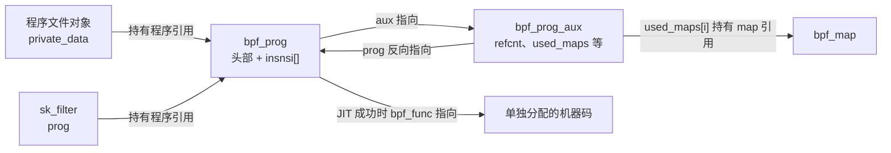
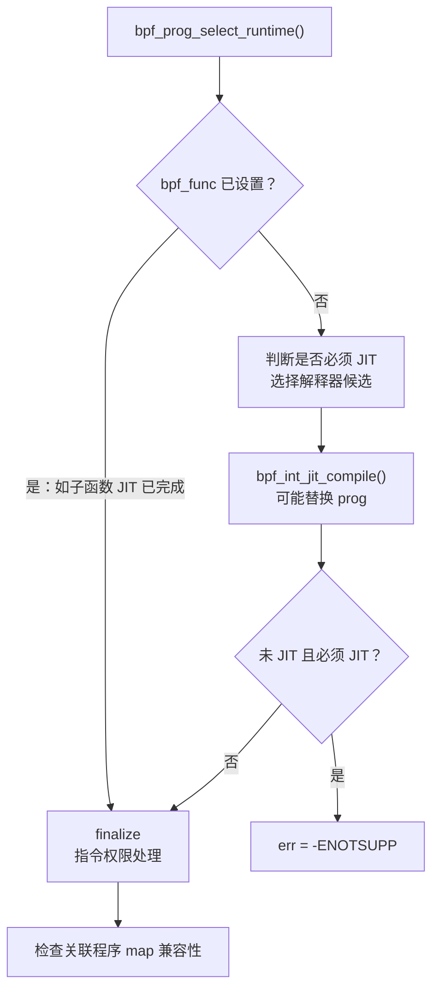
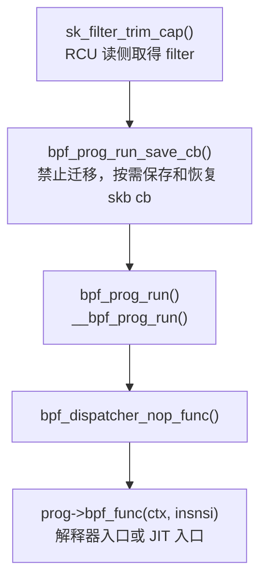

# BPF prog：从指令数组到可执行的内核程序

给一个 socket 安装过滤规则时，内核需要解决的不只是“保存一段代码”。它还要确认代码可以访问哪些数据，把用户进程中的 map fd 转换为长期有效的内核对象引用，准备执行入口，并保证替换过滤规则时，其他 CPU 正在运行的旧程序不会被提前释放。

`bpf_prog` 就是这条主线上的程序对象。它把**指令、执行入口和生命周期**连接起来：加载时接收并处理指令，挂载后由内核事件触发执行，最后在引用归零且读侧使用者退出后回收资源。本章沿这条主线分析，不把 prog、验证器、JIT 和挂载点当成彼此独立的功能清单。

读者应了解 C 的柔性数组、文件描述符、引用计数和 RCU 的基本作用。子系统的整体位置见[BPF 子系统概述](introduction.md)，map 的内部实现见[BPF map](map.md)，不同程序类型的挂载入口见[程序类型与挂载点](类型总结.md)。本章以 `BPF_PROG_LOAD` 加载的 eBPF 为主，执行与挂载采用 socket 过滤程序作为具体例子；不展开经典 BPF 转换、设备卸载、验证器全部证明规则和每一种挂载机制。

## 0. 分析基线与配置边界

源码基线为本仓库 **Linux 6.18.52**，架构选择 **x86-64**，依据是 [linux/Makefile 第 2～4 行](../../linux/Makefile#L2-L4)和 [.config 第 332～334 行](../../linux/.config#L332-L334)。以下配置影响本章主路径：

| 配置 | 对实现的影响 | 源码依据 |
| --- | --- | --- |
| `CONFIG_BPF=y`、`CONFIG_BPF_SYSCALL=y` | 编入核心运行时、系统调用和验证器 | [.config 第 117～124 行](../../linux/.config#L117-L124)、[kernel/bpf/Makefile 第 2～9 行](../../linux/kernel/bpf/Makefile#L2-L9) |
| `CONFIG_HAVE_EBPF_JIT=y`、`CONFIG_BPF_JIT=y` | 使用 x86-64 eBPF JIT 后端 | [.config 第 118～125 行](../../linux/.config#L118-L125)、[arch/x86/net/Makefile 第 6～10 行](../../linux/arch/x86/net/Makefile#L6-L10) |
| `CONFIG_ARCH_WANT_DEFAULT_BPF_JIT=y`、`CONFIG_BPF_JIT_DEFAULT_ON=y` | `bpf_jit_enable` 初值为 1 | [Kconfig 第 69～71 行](../../linux/kernel/bpf/Kconfig#L69-L71)、[core.c 第 543～547 行](../../linux/kernel/bpf/core.c#L543-L547) |
| `CONFIG_BPF_JIT_ALWAYS_ON` 未启用 | 保留解释器，但不能据此断言所有程序都能回退 | [.config 第 126 行](../../linux/.config#L126)、[运行时选择 core.c](../../linux/kernel/bpf/core.c#L2528-L2595) |
| `CONFIG_BPF_UNPRIV_DEFAULT_OFF` 未启用 | `unprivileged_bpf_disabled` 初值为 0；加载仍有权限、类型等检查 | [.config 第 128 行](../../linux/.config#L128)、[syscall.c 第 67～68 行](../../linux/kernel/bpf/syscall.c#L67-L68) |
| `CONFIG_NET=y` | 编入本章使用的 socket filter 程序类型 | [.config 第 1309 行](../../linux/.config#L1309)、[bpf_types.h 第 4～6 行](../../linux/include/linux/bpf_types.h#L4-L6) |
| `CONFIG_PREEMPT_RCU=y`、`CONFIG_TASKS_TRACE_RCU=y` | 普通程序和可睡眠程序采用不同的释放等待路径 | [.config 第 168～175 行](../../linux/.config#L168-L175)、[syscall.c 第 2406～2413 行](../../linux/kernel/bpf/syscall.c#L2406-L2413) |

JIT 的编译支持、默认开关和某个程序实际是否 JIT 是三件事。分配程序时，`jit_requested` 取自 `ebpf_jit_enabled()`；该函数读取运行时的 `bpf_jit_enable`。开关有 sysctl 接口，静态阅读 `.config` 不能确定某次加载的取值。[分配时记录请求](../../linux/kernel/bpf/core.c#L123-L128) · [`ebpf_jit_enabled()`](../../linux/include/linux/filter.h#L1377-L1380) · [sysctl 接口](../../linux/net/core/sysctl_net_core.c#L439-L450)

本配置还有一个实际限制：`.config` 的 `CONFIG_PAHOLE_VERSION=0`，而 `DEBUG_INFO_BTF` 依赖 `PAHOLE_VERSION >= 116`，因此本构建不启用内核 BTF。`bpf_get_btf_vmlinux()` 只有在该配置启用时才解析 vmlinux BTF；没有内核 BTF 时，指定 `attach_btf_id` 并回退到 vmlinux BTF 的加载路径返回 `-EINVAL`，kfunc 注册检查返回 `-ENOTSUPP`。这不等同于禁止用户加载程序自身的 BTF，也不影响不依赖内核 BTF 的普通 socket filter 主线。[配置与依赖](../../linux/.config#L26) · [Kconfig.debug 第 377～383 行](../../linux/lib/Kconfig.debug#L377-L383) · [vmlinux BTF 获取](../../linux/kernel/bpf/verifier.c#L24432-L24452) · [挂载目标检查](../../linux/kernel/bpf/syscall.c#L2968-L2979) · [kfunc 检查](../../linux/kernel/bpf/verifier.c#L3330-L3338)

## 1. prog 解决什么问题

### 1.1 程序对象、一次运行和挂载关系

这三个概念需要先分开：

| 概念 | 表示什么 | 生命周期 |
| --- | --- | --- |
| 程序对象 `bpf_prog` | 一份处理后的指令、执行入口及关联资源 | 从加载到最后一个持有者放弃引用，再延迟释放 |
| 一次运行 | 在给定上下文上执行程序，产生返回值和副作用 | 从挂载点调用入口到执行返回；解释器的寄存器和栈属于这次调用 |
| 挂载关系 | 某个内核事件应当调用哪个程序 | 由 socket、link 或其他挂载子系统维护 |

依据分别是 [prog 的定义](../../linux/include/linux/bpf.h#L1701-L1737)、[解释器调用帧](../../linux/kernel/bpf/core.c#L2341-L2352)以及 [socket 安装过滤器](../../linux/net/core/filter.c#L1481-L1504)。程序对象可以被多次执行；`BPF_PROG_LOAD` 返回程序 fd，并不自动把它安装到 socket 上。[加载返回 fd](../../linux/kernel/bpf/syscall.c#L3120-L3123) · [独立的 socket 挂载入口](../../linux/net/core/filter.c#L1600-L1614)

### 1.2 从加载到释放的整体流程

下图回答“程序什么时候形成、什么时候开始被事件使用”。箭头表示阶段推进，采用概念层次的简化：设备卸载等分支省略，验证阶段内部的子函数 JIT 会在第 4 节展开。


加载主线来自 [`bpf_prog_load()`](../../linux/kernel/bpf/syscall.c#L2993-L3123)，挂载和执行的具体例子来自 [`sk_attach_bpf()`](../../linux/net/core/filter.c#L1600-L1614)与 [`sk_filter_trim_cap()`](../../linux/net/core/filter.c#L162-L175)，引用归零的处理见 [`__bpf_prog_put()`](../../linux/kernel/bpf/syscall.c#L2429-L2440)。

这条主线跨过两种执行环境。加载工作发生在系统调用的进程上下文，可以进行 `GFP_KERNEL` 分配；事件触发的程序则在挂载点的上下文运行。`bpf_prog_run()` 不创建线程，也不切换到某种统一的“BPF 上下文”。例如 socket filter 的调用者在 RCU 读侧执行程序，并由包装函数禁止迁移。[加载期分配](../../linux/kernel/bpf/core.c#L100-L111) · [直接调用执行入口](../../linux/include/linux/bpf.h#L1331-L1336) · [socket 执行的保护](../../linux/net/core/filter.c#L162-L175) · [禁止迁移](../../linux/include/linux/filter.h#L1020-L1028)

## 2. 核心数据结构：代码、元数据和引用

### 2.1 输入是指令槽数组

系统调用接收的是 `struct bpf_insn` 数组。每个槽 8 字节，包含操作码、源和目的寄存器编号、16 位有符号偏移和 32 位有符号立即数；`insn_cnt` 以槽为单位。加载 64 位立即数占两个连续槽，验证器会检查第二槽的格式，因此“指令槽数”不能直接当成高级语言语句数。[`bpf_insn` 定义](../../linux/include/uapi/linux/bpf.h#L80-L86) · [双槽格式检查](../../linux/kernel/bpf/verifier.c#L20961-L20977)

程序的接口寄存器编号为 `R0`～`R10`。其中 `R0` 接收调用返回值，`R1`～`R5` 传递参数，`R6`～`R9` 跨函数调用保留，`R10` 作为帧指针；普通主程序入口的 `R1` 被验证器标记为上下文指针。这里的编号描述 BPF 指令模型，x86-64 JIT 会另行映射到机器寄存器。[寄存器编号](../../linux/include/uapi/linux/bpf.h#L61-L78) · [调用约定](../../linux/kernel/bpf/core.c#L2079-L2086) · [入口上下文类型](../../linux/kernel/bpf/verifier.c#L23660-L23673) · [x86-64 映射](../../linux/arch/x86/net/bpf_jit_comp.c#L181-L197)

### 2.2 `bpf_prog`：执行时需要的程序表示

`bpf_prog` 的尾部是柔性指令数组。它还保留程序类型、执行方式和执行入口，而不是把它们放到某个 fd 的私有副本里。同一对象的不同持有者会使用同一个入口。[`struct bpf_prog`](../../linux/include/linux/bpf.h#L1701-L1737)

| 字段 | 含义与单位 | 阅读时的约束 |
| --- | --- | --- |
| `type`、`expected_attach_type` | 程序类型和预期挂载类型 | 前者决定类型回调，后者参与特定类型的加载及挂载检查 |
| `len` | 当前 BPF 指令槽数 | 验证和改写后可能与输入 `insn_cnt` 不同 |
| `pages` | prog 本体的分配页数 | 包含结构头和指令区，不是 JIT 代码的页数 |
| `jit_requested`、`jited` | 请求使用 JIT、已得到 JIT 结果 | 请求成功与实际编译成功需要分别判断 |
| `jited_len` | 该入口对应 JIT 指令区的字节数 | 多函数程序还有各函数自己的代码长度 |
| `bpf_func` | 可调用的执行入口 | 指向解释器函数或生成的机器码 |
| `stats`、`active` | 每 CPU 统计对象、递归计数存储 | 两块独立分配的每 CPU 数据，不是本体中的数组 |
| `aux` | 指向辅助元数据 | 单独分配；两者在扩容时有不同的地址稳定性 |
| `insnsi[]` | 处理后的 eBPF 指令 | 位于本体尾部；JIT 代码另行分配 |

字段布局见 [bpf.h 第 1701～1737 行](../../linux/include/linux/bpf.h#L1701-L1737)，分配和入口选择见 [core.c 第 100～171 行](../../linux/kernel/bpf/core.c#L100-L171)与 [core.c 第 2528～2614 行](../../linux/kernel/bpf/core.c#L2528-L2614)。`len` 的改写见 [`bpf_patch_insn_single()`](../../linux/kernel/bpf/core.c#L466-L486)，多函数代码的入口与长度见 [verifier.c 第 22135～22142 行](../../linux/kernel/bpf/verifier.c#L22135-L22142)。

### 2.3 `bpf_prog_aux`：长期保存的管理信息

辅助结构的关键内容可以按职责理解：

| 职责 | 字段 | 对象关系或保护方式 |
| --- | --- | --- |
| 程序生命周期 | `refcnt`、`prog`、`main_prog_aux` | 原子引用计数；`prog` 是反向指针，主程序分配时 `main_prog_aux` 指向自身 |
| 对外识别 | `id`、`name`、`load_time` | ID 由全局 IDR 管理；加载时间单位是开机以来的纳秒 |
| 验证结果 | `stack_depth`、`max_ctx_offset`、`verified_insns` | 栈深度及上下文访问范围按字节记录；`verified_insns` 记录分析处理的指令次数 |
| 程序关联的 map | `used_maps`、`used_map_cnt`、`used_maps_mutex` | 指针数组，每个记录对应程序持有的一份 map 引用；互斥锁保护数组及数量 |
| 程序及目标的类型信息 | `btf`、`attach_btf`、`attach_btf_id` | 程序自身 BTF 与挂载目标 BTF 是不同关系 |
| 子函数与 JIT 工作数据 | `func`、`func_cnt`、`real_func_cnt`、`jit_data` | `func` 指向内部函数程序数组；`real_func_cnt` 包括隐藏函数，参与释放 |
| 目标程序及 trampoline | `dst_prog`、`dst_trampoline`、`dst_mutex` | 可见后的目标指针由 `dst_mutex` 保护；释放时归还对应引用 |
| 类型回调 | `ops` | 指向静态 `bpf_prog_ops` 表，不是引用计数对象 |
| 延迟处理 | `work`、`rcu` | 二者位于同一联合体，按释放阶段先后使用 |

定义与字段注释见 [bpf.h 第 1588～1697 行](../../linux/include/linux/bpf.h#L1588-L1697)，初始化见 [core.c 第 123～139 行](../../linux/kernel/bpf/core.c#L123-L139)，验证统计赋值见 [verifier.c 第 25139～25141 行](../../linux/kernel/bpf/verifier.c#L25139-L25141)，目标引用的归还见 [core.c 第 2969～2995 行](../../linux/kernel/bpf/core.c#L2969-L2995)。

`used_maps` 也不能被理解成“程序一定执行访问的全部 map”。加载时的 `fd_array_cnt` 可以绑定未被指令直接引用的 map；加载后 `BPF_PROG_BIND_MAP` 还可以在 `used_maps_mutex` 下替换数组，增加关联引用。因此程序可执行代码已经确定，不代表 aux 的所有管理信息都不可变。[加载属性的绑定约定](../../linux/include/uapi/linux/bpf.h#L1604-L1613) · [`bpf_prog_bind_map()`](../../linux/kernel/bpf/syscall.c#L6072-L6121)

### 2.4 指针关系不等于引用关系

下图只画普通 socket filter 程序与一个关联 map。箭头上的文字明确区分“指向”和“持有引用”；prog、aux、map、JIT 指令区均不是同一次内存分配。



文件与 socket 的引用来源见 [创建 fd](../../linux/kernel/bpf/syscall.c#L2544-L2553)、[从 fd 增加程序引用](../../linux/kernel/bpf/syscall.c#L2608-L2624)和 [socket 接收该引用](../../linux/net/core/filter.c#L1600-L1614)；map 引用见 [verifier.c 第 20906～20913 行](../../linux/kernel/bpf/verifier.c#L20906-L20913)。`aux->prog` 不增加 `refcnt`，机器码地址也不是一份独立的程序引用；它们随程序的资源管理路径回收。[互指初始化](../../linux/kernel/bpf/core.c#L123-L126) · [JIT 资源释放](../../linux/arch/x86/net/bpf_jit_comp.c#L3881-L3913)

## 3. 加载算法：建立可以发布的程序对象

### 3.1 系统调用接收什么

`__sys_bpf()` 先检查超出内核已知属性大小的尾部，清零本地 `union bpf_attr`，再复制用户提交的部分；`BPF_PROG_LOAD` 分派给 `bpf_prog_load()`。后者继续检查当前命令不使用的属性字段和未知程序标志。[通用入口](../../linux/kernel/bpf/syscall.c#L6160-L6177) · [命令分派](../../linux/kernel/bpf/syscall.c#L6198-L6200) · [加载属性检查](../../linux/kernel/bpf/syscall.c#L2882-L2894)

理解主线所需的输入如下，完整 UAPI 定义见 [bpf.h 第 1560～1623 行](../../linux/include/uapi/linux/bpf.h#L1560-L1623)：

| 输入 | 用途 |
| --- | --- |
| `prog_type`、`expected_attach_type` | 选择程序契约，确定上下文访问及 helper 等约束 |
| `insns`、`insn_cnt` | 指令数组的用户地址与槽数；内核复制后处理自己的数组 |
| `license` | 许可证字符串地址，用于设置 `gpl_compatible` |
| `prog_flags` | 对齐要求、可睡眠等加载属性 |
| `prog_btf_fd`、`func_info`、`line_info` | 程序类型、函数及行信息 |
| `attach_btf_id`、`attach_prog_fd` / `attach_btf_obj_fd` | 某些程序的目标信息；后两个 fd 字段共享存储 |
| `log_level`、`log_buf`、`log_size` | 验证日志参数；`log_true_size` 是日志实际总大小的输出 |

**加载输入不是 ELF 文件。**主路径按 `insn_cnt` 分配程序，再按指令字节数复制 `insns`；它没有在这里解析 ELF 段。[指令复制](../../linux/kernel/bpf/syscall.c#L2993-L3023) · [字节数计算](../../linux/include/linux/filter.h#L1052-L1055)

### 3.2 先检查权限和目标，再承担对象资源

程序加载权限并非一个简单的“是否 root”判断。设置 `BPF_F_TOKEN_FD` 时会取得 token，检查它是否授权当前命令、程序类型和预期挂载类型；不满足这些授权条件的 token 被放弃，回到系统能力检查。随后得到 `bpf_cap`，结合非特权开关、程序类型及额外能力要求判断是否允许加载。[token 与能力检查](../../linux/kernel/bpf/syscall.c#L2898-L2945)

指令槽数必须非零。有 `CAP_BPF` 对应加载能力时，输入上限使用 `BPF_COMPLEXITY_LIMIT_INSNS=1000000`；否则使用 `BPF_MAXINSNS=4096`。非特权类型还限制为 socket filter 与 cgroup skb，并仍受其他检查约束。[加载数量和类型检查](../../linux/kernel/bpf/syscall.c#L2932-L2945) · [两个常量](../../linux/include/linux/bpf.h#L2088) · [`BPF_MAXINSNS`](../../linux/include/uapi/linux/bpf_common.h#L54)

这里的“输入长度上限”与后文的“验证器分析工作量上限”不能混为一谈：后者统计探索路径时处理指令的次数，同一条输入指令可以被分析多次。[工作量检查](../../linux/kernel/bpf/verifier.c#L20406-L20410)

目标程序或目标 BTF 的引用在分配 prog 之前取得，挂载类型组合也在此检查；分配失败或组合不合法时，尚未交给 prog 的引用由当前加载路径归还。[取得目标引用](../../linux/kernel/bpf/syscall.c#L2947-L2980) · [目标检查与分配失败清理](../../linux/kernel/bpf/syscall.c#L2982-L3001)

### 3.3 分配、初始化与类型契约

`bpf_prog_size(insn_cnt)` 计算容纳结构头及指令尾部的大小，并确保至少有 `sizeof(struct bpf_prog)`。`bpf_prog_alloc_no_stats()` 将大小向页对齐，用 `__vmalloc()` 分配本体，再用 `kzalloc()` 分配 aux，用每 CPU 分配接口准备 `active`；外层 `bpf_prog_alloc()` 再分配 `stats`。任一中间分配失败都会清理已取得的内存。[大小计算](../../linux/include/linux/filter.h#L1057-L1061) · [本体、aux 与 active](../../linux/kernel/bpf/core.c#L100-L145) · [stats 与失败处理](../../linux/kernel/bpf/core.c#L148-L171)

加载层接着设置挂载属性、目标引用、创建者与 `len`，复制指令和许可证，并设置 `gpl_compatible`。如果用户提供签名，还会进入签名验证。之后初始化程序引用计数为 1；这份初始引用最终交给新建的程序文件对象，发布前失败则由加载路径回收。[初始化和复制](../../linux/kernel/bpf/syscall.c#L3004-L3043) · [fd 创建及失败归还](../../linux/kernel/bpf/syscall.c#L3120-L3123)

许可证兼容性影响可调用的接口：非 GPL 兼容程序不能调用 `gpl_only` helper。它不替代指令验证，也不要求所有程序都声明 GPL。[许可证记录](../../linux/kernel/bpf/syscall.c#L3031-L3032) · [GPL helper 检查](../../linux/kernel/bpf/verifier.c#L11541-L11545)

接下来的类型选择分为两组表，不应混淆：

| 回调表 | 谁选择、放在哪里 | 解决什么问题 |
| --- | --- | --- |
| `bpf_prog_ops` | `find_prog_type()` 选择并保存到 `aux->ops` | 当前定义提供 `test_run`，用于类型专属的测试执行 |
| `bpf_verifier_ops` | `bpf_check()` 按程序类型选择到 `env->ops` | helper 原型、上下文访问合法性、上下文指令转换等 |

两组表都由 `bpf_types.h` 展开生成，类型没有对应表项时加载失败；它们不是 JIT 机器码的执行入口。[prog 表与选择](../../linux/kernel/bpf/syscall.c#L2286-L2313) · [verifier 表](../../linux/kernel/bpf/verifier.c#L36-L45) · [验证器选择](../../linux/kernel/bpf/verifier.c#L24974-L24975) · [两种 ops 的定义](../../linux/include/linux/bpf.h#L1047-L1078)

例如 socket filter 使用 `sk_filter_verifier_ops` 约束上下文访问，使用 `sk_filter_prog_ops.test_run` 提供 skb 测试路径；正常收包执行并不通过这两个表分派。[socket filter 两组回调](../../linux/net/core/filter.c#L11169-L11178) · [收包直接执行](../../linux/net/core/filter.c#L169)

### 3.4 验证器既检查指令，也建立资源关系

加载层通过 `bpf_check(&prog, ...)` 进入验证器，返回后再选择运行时。二级指针允许验证器把新的程序地址交回调用者；验证器并非只返回一个布尔值。[两个加载期步骤](../../linux/kernel/bpf/syscall.c#L3089-L3096) · [返回更新后的 prog](../../linux/kernel/bpf/verifier.c#L25211)

先看程序关联 map 的过程。输入的 `BPF_PSEUDO_MAP_FD` 指令里存的是进程的 fd，运行时不能继续依赖它。验证器会：

1. 从 fd 找到 map，检查对象与程序是否兼容，并按指针去重。
2. 为第一次记录的 map 增加引用，暂存到 `env->used_maps`；可睡眠程序还增加 map 的 `sleepable_refcnt`。
3. 把两个立即数槽改成 map 内核地址的低、高 32 位，并在指令辅助数据中保留 map 索引，供后续分析使用。
4. 成功结束时，把指针集合复制到 `aux->used_maps`，将引用释放责任交给程序；失败且未转交时，由验证器归还引用。

依据是 [取得并记录 map](../../linux/kernel/bpf/verifier.c#L20884-L20934)、[fd 转换与指令改写](../../linux/kernel/bpf/verifier.c#L21010-L21063)及 [转交与失败处理](../../linux/kernel/bpf/verifier.c#L25158-L25203)。`BPF_PSEUDO_MAP_VALUE` 等直接访问 value 的形式还有偏移和 map 操作能力检查，不能一概写成“所有伪指令都改成 map 本体指针”。[直接 value 地址分支](../../linux/kernel/bpf/verifier.c#L21035-L21059)

这条关系带来一个具体结果：程序加载成功后关闭原 map fd，不会撤销程序已持有的 map 引用。程序使用的是内核对象，释放时才由 `bpf_map_put()` 归还这份引用。[引用取得](../../linux/kernel/bpf/verifier.c#L20906-L20913) · [引用归还](../../linux/kernel/bpf/core.c#L2909-L2917)

### 3.5 加载期分析留下什么

验证器为本次加载分配 `bpf_verifier_env` 和逐指令辅助数组，再检查函数信息、伪立即数、控制流及主程序和子函数。它对寄存器维护的是类型、来源、偏移和取值范围等**抽象状态**；对栈维护逐字节槽类型及暂存的寄存器状态，不会在这里拿一个真实网络包试跑用户指令。[工作区创建](../../linux/kernel/bpf/verifier.c#L24960-L24975) · [分析阶段](../../linux/kernel/bpf/verifier.c#L25032-L25087) · [寄存器状态](../../linux/include/linux/bpf_verifier.h#L37-L65) · [取值范围](../../linux/include/linux/bpf_verifier.h#L112-L131) · [栈状态](../../linux/include/linux/bpf_verifier.h#L235-L238)

本章只关注这些分析与 prog 的接口：

| 分析内容 | 如何影响程序对象或执行契约 |
| --- | --- |
| 上下文访问是否合法 | 调用类型的 `is_valid_access`；记录 `max_ctx_offset`，为后续转换提供访问信息 |
| helper 是否允许 | 检查类型、许可证和是否可能睡眠等约束 |
| 路径和循环是否满足规则 | 非特权程序在控制流检查中拒绝回边；允许继续分析的路径仍会经过状态和工作量检查 |
| 引用与返回值 | 检查需归还的资源引用，按类型检查出口返回值 |
| 栈及函数调用 | 检查最大栈深度，准备解释器调用参数或内部函数 JIT |

对应实现见 [上下文访问](../../linux/kernel/bpf/verifier.c#L6259-L6284)、[helper 检查](../../linux/kernel/bpf/verifier.c#L11527-L11555)、[回边条件](../../linux/kernel/bpf/verifier.c#L17830-L17836)、[循环状态检查](../../linux/kernel/bpf/verifier.c#L19844-L19856)、[工作量上限](../../linux/kernel/bpf/verifier.c#L20406-L20410)、[引用泄漏检查](../../linux/kernel/bpf/verifier.c#L11329-L11353)、[出口检查](../../linux/kernel/bpf/verifier.c#L20214-L20217)及 [栈与调用准备](../../linux/kernel/bpf/verifier.c#L25101-L25137)。所以既不能说“BPF 禁止所有循环”，也不能把验证通过解释成过滤策略在业务上一定正确。

验证成功后，程序保留关联 map/BTF、访问范围、栈深度等结果，路径分析的工作区会释放。日志初始化、最终整理及 `log_true_size` 写回也属于加载流程，其中的错误同样可能使加载失败。[验证日志初始化](../../linux/kernel/bpf/verifier.c#L24989-L24996) · [日志与结果处理](../../linux/kernel/bpf/verifier.c#L25139-L25156) · [最终工作区释放](../../linux/kernel/bpf/verifier.c#L25214-L25223)

### 3.6 改写指令为何可能改变 prog 的地址

验证通过的访问仍需要落到真实内核布局。例如 socket filter 的程序契约以 `struct __sk_buff` 描述上下文字段，实际执行收到的是 `struct sk_buff *`。`bpf_convert_ctx_access()` 会把读取 `__sk_buff.len` 的指令，转换为读取 `sk_buff.len` 的指令；它没有要求运行时先复制一个完整的 `__sk_buff`。[两种上下文类型](../../linux/include/linux/bpf_types.h#L5-L6) · [len 字段转换](../../linux/net/core/filter.c#L9714-L9727) · [实际传入 skb](../../linux/net/core/filter.c#L169)

对未被内联替换的普通 helper 调用，修正阶段将原 helper ID 改为相对 `__bpf_call_base` 的函数偏移；解释器再按“基址加偏移”调用。因此处理后的指令与用户输入可以不同，内核也不必在每次普通 helper 调用时重新做按 ID 查表和许可检查。[helper 调用修正](../../linux/kernel/bpf/verifier.c#L23254-L23265) · [解释器调用](../../linux/kernel/bpf/core.c#L2080-L2086)

一条上下文访问等指令可能被展开为多条。`bpf_patch_insn_single()` 先检查可能的跳转偏移溢出，再调用 `bpf_prog_realloc()` 留出空间，移动尾部、写入补丁、修正分支偏移和行信息；验证器层还同步修正指令辅助数据、子函数起点等位置。[补丁的检查和扩容](../../linux/kernel/bpf/core.c#L452-L486) · [移动及分支修正](../../linux/kernel/bpf/core.c#L488-L508) · [验证器位置修正](../../linux/kernel/bpf/verifier.c#L21175-L21203)

扩容并不每次都分配新对象：现有页数足够时直接返回旧地址。确实需要新内存时，复制 prog，继续使用原 aux、stats 和 active，更新 `aux->prog` 后清空旧 prog 的这些指针再释放旧本体。[`bpf_prog_realloc()`](../../linux/kernel/bpf/core.c#L255-L282)

```text
扩容前：旧 prog ──aux──> 同一个 aux ──prog──> 旧 prog
扩容后：新 prog ──aux──> 同一个 aux ──prog──> 新 prog
        旧 prog 本体释放，aux / stats / active 转交新 prog
```

这是加载期所有权转交的示意，不代表对已发布程序进行并发扩容。理解这点后，`bpf_check()` 的二级指针、`env->prog` 的更新以及独立的 aux 分配就连成了一条因果链。

## 4. 运行时选择：准备一个可以直接调用的入口

### 4.1 先有解释器候选，再尝试 JIT

对本章普通的、未设备卸载的单函数程序，`bpf_prog_select_runtime()` 的目标是确定 `bpf_func`，并检查最终执行方式是否满足关联程序 map 的兼容条件。它接收处理后的 prog，通过 `err` 输出错误，并返回最终的 prog 指针；JIT 的常量盲化等操作也可能替换对象。[运行时选择](../../linux/kernel/bpf/core.c#L2551-L2615)

下面的图表示该函数的实际分支顺序，省略设备卸载编译路径：



依据是 [core.c 第 2569～2612 行](../../linux/kernel/bpf/core.c#L2569-L2612)。最终使用解释器时，`bpf_prog_lock_ro()` 将 prog 本体设为只读；JIT 程序的该步骤直接返回，机器码的权限由 JIT 分配和提交路径处理。不能把两者概括成“所有 prog 内存都在同一处设成只读可执行”。[`bpf_prog_lock_ro()`](../../linux/include/linux/filter.h#L1109-L1117)

解释器选择依据验证得到的栈深度，按 32 字节向上对齐选择函数；生成的解释器入口覆盖 32～512 字节。零栈深度也选择最小的 32 字节入口。如果需要的深度超出候选范围，就没有有效解释器候选，必须得到 JIT 结果。[候选选择](../../linux/kernel/bpf/core.c#L2528-L2548) · [解释器入口集合](../../linux/kernel/bpf/core.c#L2379-L2394)

例如分析结果为 40 字节时，候选入口准备 64 字节的局部栈；普通用户指令栈的边界常量仍是 `MAX_BPF_STACK=512`。JIT 改写可以引入额外栈槽，所以不能把“BPF 可访问栈的限制”直接当成所有内核执行帧的实际分配大小。[栈限制常量](../../linux/include/linux/filter.h#L99-L100) · [额外栈深度处理](../../linux/kernel/bpf/verifier.c#L23267-L23273)

### 4.2 有解释器不代表任意程序都能回退

需要把两类结果区分开：**允许解释执行的程序未得到 JIT，可以继续加载；依赖 JIT 能力的程序未得到 JIT，应当拒绝。**除了运行时选择本身认定的 JIT 必需条件，验证器在此前已经执行过更具体的限制。

| 情况 | 本地实现的行为 |
| --- | --- |
| 普通程序未获得 JIT，且存在解释器候选 | 保留已设置的解释器入口，继续完成最终检查 |
| `BPF_JIT_ALWAYS_ON` 启用、含 kfunc，或没有可用解释器入口 | 运行时选择要求 JIT，未生成代码时返回 `-ENOTSUPP` |
| BPF 子函数调用与 tail call 混用 | 子函数 JIT 未成功时，解释器回退路径拒绝这种组合 |
| 使用函数指针形式的 BPF 回调 | 子函数 JIT 未成功时，回退路径拒绝伪函数地址指令 |
| 使用 arena map | 加载期要求请求 JIT 且后端支持 arena；这已不同于普通 map 的主路径 |

依据：[运行时选择与 JIT 必需条件](../../linux/kernel/bpf/core.c#L2569-L2595)、[子函数、kfunc 和回调回退限制](../../linux/kernel/bpf/verifier.c#L22191-L22229)、[arena 的加载条件](../../linux/kernel/bpf/verifier.c#L20857-L20878)。当前配置未开启 `BPF_JIT_ALWAYS_ON`，且缺少内核 BTF，kfunc 程序会更早失败；表中保留这些通用实现是为了界定“可回退”的边界。

### 4.3 x86-64 JIT 为什么要多轮生成

`arch/x86/net/bpf_jit_comp.c` 的 `bpf_int_jit_compile()` 首先检查 `jit_requested`，未请求就返回原程序。请求 JIT 时先尝试常量盲化，失败也返回原程序，由上一层结合是否必须 JIT 判断最终结果。[JIT 入口](../../linux/arch/x86/net/bpf_jit_comp.c#L3647-L3679)

真正生成代码时，需要将 BPF 槽位置映射到机器码位置。x86-64 指令长度可变，跳转编码还涉及短、长位移，不能按“每个 BPF 槽固定对应若干机器码字节”计算。后端为 `len + 1` 个位置分配 `addrs`，先做粗略估算，再反复调用 `do_jit()` 更新总长度和位置；后期启用 padding，长度稳定后分配机器码空间，随后写出并检查最终长度。`MAX_PASSES` 定为 20，循环还为已经分配的 image 留出最终生成机会。[位置估算与生成循环](../../linux/arch/x86/net/bpf_jit_comp.c#L3719-L3795) · [x86 跳转编码说明](../../linux/arch/x86/net/bpf_jit_comp.c#L151-L164)

机器寄存器映射则让调用约定落到硬件上：`R0` 对应 `RAX`，`R1`～`R5` 对应 `RDI/RSI/RDX/RCX/R8`，`R6`～`R9` 对应 `RBX/R13/R14/R15`，BPF 帧指针对应 `RBP`。这里的 BPF `R10` 与 x86 的机器寄存器 `R10` 是两个编号体系；后者还可被 JIT 用作临时寄存器。[`reg2hex[]`](../../linux/arch/x86/net/bpf_jit_comp.c#L171-L197)

### 4.4 可写生成区与最终机器码区

本地 x86-64 后端采用 `bpf_jit_binary_pack_alloc()`，同时取得最终指令区和可写缓冲区。源码的契约是：最终区为只读、可执行，后端以它的地址计算位移，但把字节写到可写缓冲区。完成后 `bpf_jit_binary_pack_finalize()` 通过架构接口复制到最终区并释放缓冲区；x86 的架构接口使用 `text_poke_copy()`。[双区域分配契约](../../linux/kernel/bpf/core.c#L1157-L1208) · [代码提交](../../linux/kernel/bpf/core.c#L1211-L1225) · [x86 文本复制](../../linux/arch/x86/net/bpf_jit_comp.c#L3863-L3867)

这说明程序的三种地址不能混用：

```text
prog->insnsi       BPF 指令数组，位于 prog 本体尾部
rw_image          JIT 生成期间写入的临时机器码地址
image / bpf_func  最终机器码所在区域及其中的执行入口
```

提交成功后，后端将 `bpf_func` 设为最终 image 加上 CFI 所需的入口偏移，设置 `jited=1` 并记录 `jited_len`。因此 `bpf_func` 不一定恰好等于分配区域的首地址，释放也需要恢复对应的区域位置。[入口及长度赋值](../../linux/arch/x86/net/bpf_jit_comp.c#L3800-L3833) · [x86 JIT 释放](../../linux/arch/x86/net/bpf_jit_comp.c#L3900-L3913)

### 4.5 一个公开 prog 为什么还会包含内部函数 prog

包含 BPF 子函数调用的程序，在 `bpf_check()` 的 `fixup_call_args()` 阶段就可能走 `jit_subprogs()`。它先为各函数分配内部 `bpf_prog`，进行 JIT；得到函数地址后修正调用，再进行额外编译处理。内部函数没有单独的全局 ID，使用 `bpf_prog_alloc_no_stats()`，运行时间计入主程序。[调用准备入口](../../linux/kernel/bpf/verifier.c#L22181-L22198) · [内部对象分配及统计约定](../../linux/kernel/bpf/verifier.c#L21974-L21986) · [首轮和后续 JIT](../../linux/kernel/bpf/verifier.c#L22051-L22060) · [额外编译](../../linux/kernel/bpf/verifier.c#L22093-L22102)

成功后，公开主 prog 的 `bpf_func` 指向 `func[0]->bpf_func`，aux 保存 `func`、`func_cnt` 和包含隐藏函数的 `real_func_cnt`。这就是随后 `bpf_prog_select_runtime()` 看到已有入口、直接进入 finalize 的原因。[主对象接收结果](../../linux/kernel/bpf/verifier.c#L22135-L22145) · [已有入口分支](../../linux/kernel/bpf/core.c#L2564-L2570)

还要注意长度的口径：主 prog 的 `jited_len` 在这里取自 `func[0]`，用户查询的 `bpf_prog_info.jited_prog_len` 则会汇总 `func_cnt` 个函数的长度。它们不能无条件画等号。[主入口长度](../../linux/kernel/bpf/verifier.c#L22135-L22142) · [查询汇总](../../linux/kernel/bpf/syscall.c#L5104-L5113)

## 5. 挂载与执行：以 socket filter 为例

### 5.1 挂载取得的是程序引用

用户对 socket 设置 `SO_ATTACH_BPF` 时传入程序 fd，socket 选项处理调用 `sk_attach_bpf()`。它先按 `BPF_PROG_TYPE_SOCKET_FILTER` 取得程序：fd 必须存在，文件操作表必须是 `bpf_prog_fops`，类型必须匹配，然后增加 `aux->refcnt`。[socket 选项入口](../../linux/net/core/sock.c#L1461-L1471) · [程序类型要求](../../linux/net/core/filter.c#L1592-L1614) · [fd 和类型检查](../../linux/kernel/bpf/syscall.c#L2593-L2624)

`__sk_attach_prog()` 创建 `sk_filter` 包装对象，把取得的引用放到 `fp->prog`。在调用者持有 socket 锁的条件下，使用 `rcu_assign_pointer()` 发布 `sk->sk_filter`，随后解除旧过滤器的持有关系。成功时这份程序引用由包装对象接管；失败时 `sk_attach_bpf()` 调用 `bpf_prog_put()`，不会泄漏引用。[安装与旧对象处理](../../linux/net/core/filter.c#L1481-L1504) · [失败归还](../../linux/net/core/filter.c#L1608-L1614)

这里同时存在两种计数：`sk_filter.refcnt` 管包装对象，`bpf_prog_aux.refcnt` 管程序。包装对象中的 `prog` 指针在这条路径上确实有对应引用，而不是只借用一个地址。[`sk_filter` 定义](../../linux/include/linux/filter.h#L714-L718) · [包装对象初始化](../../linux/net/core/filter.c#L1489-L1495) · [包装对象释放程序引用](../../linux/net/core/filter.c#L1192-L1228)

### 5.2 一个收到的 skb 怎样进入程序

`sk_filter_trim_cap()` 先进行相关的 cgroup 和安全检查，通过后才进入本节的 socket filter 路径。在 RCU 读侧读取 `sk->sk_filter`，暂存并设置 `skb->sk`，调用 `bpf_prog_run_save_cb()`，恢复 `skb->sk`，最后解释程序返回值。[收包过滤实现](../../linux/net/core/filter.c#L150-L175)

下面按职责分层展示调用关系。箭头只表示函数调用；socket filter 的外层 RCU 区间以及包装函数的迁移约束标在节点中。



依据：[收包调用点](../../linux/net/core/filter.c#L162-L175)、[cb 包装与迁移约束](../../linux/include/linux/filter.h#L999-L1028)、[运行入口](../../linux/include/linux/filter.h#L732-L763)和 [dispatcher 的直接调用](../../linux/include/linux/bpf.h#L1331-L1336)。这张图只适用于本节路径，其他挂载点可以使用不同包装、专用 dispatcher 或 trampoline。

返回值由 socket filter 挂载点解释：0 使这里返回 `-EPERM`；非零值作为长度参与 `pskb_trim(skb, max(cap, pkt_len))`，限制交给 socket 的数据长度，并受到调用者的 `cap` 下限约束。不是所有 BPF 程序都采用“0 丢弃、非零通过”，也不是所有非零值都只是布尔值。[socket 返回值处理](../../linux/net/core/filter.c#L169-L173)

### 5.3 统一入口怎样接上两种执行方式

普通 dispatcher 最终执行 `bpf_func(ctx, insnsi)`。当它指向解释器时，入口创建局部寄存器数组和栈，将帧指针设置为栈顶，把 `ctx` 放到第一个参数寄存器，再进入 `___bpf_prog_run()`。后者按操作码跳转表解码并执行；`BPF_EXIT` 返回 `R0`。[直接调用](../../linux/include/linux/bpf.h#L1331-L1336) · [解释器入口初始化](../../linux/kernel/bpf/core.c#L2341-L2352) · [解释器跳转表](../../linux/kernel/bpf/core.c#L1793-L1821) · [返回值](../../linux/kernel/bpf/core.c#L2130-L2131)

当入口指向 x86-64 JIT 代码时，这次调用直接进入已经生成的机器码，无需再按 BPF 操作码逐条解码。两种方式共享挂载点传入的上下文契约；原 BPF 指令数组还留在 prog 中，可用于处理后的指令查询。[JIT 入口赋值](../../linux/arch/x86/net/bpf_jit_comp.c#L3831-L3833) · [指令查询来源](../../linux/kernel/bpf/syscall.c#L5072-L5088)

运行入口还包含按静态分支控制的统计路径。开启 `bpf_stats_enabled_key` 时，`__bpf_prog_run()` 记录开始时间、调用入口，再将计数和时间差加入当前 CPU 的统计对象；更新通过 `u64_stats_update_begin_irqsave()` 等同步接口保护。关闭时直接调用入口，不进行这段计时统计。[统计字段](../../linux/include/linux/filter.h#L702-L707) · [统计分支](../../linux/include/linux/filter.h#L738-L756)

### 5.4 执行约束需要由调用路径兑现

`__bpf_prog_run()` 使用 `cant_migrate()` 检查调用条件，它本身没有调用 `rcu_read_lock()`，也没有为每次执行增加程序引用。普通的 `bpf_prog_run_pin_on_cpu()` 会显式禁止迁移，但“禁止迁移”和“程序生命周期受保护”仍是两件事。socket 示例由外层 RCU 区间和持有程序引用的 `sk_filter` 共同保证后者。[基础入口和迁移包装](../../linux/include/linux/filter.h#L732-L781) · [socket 的 RCU 使用](../../linux/net/core/filter.c#L162-L175)

可睡眠程序也不能靠任意设置标志把某个挂载点变成可睡眠上下文。加载时记录 `BPF_F_SLEEPABLE`，验证器检查程序类型是否支持；它还会拒绝非可睡眠分析状态调用 `might_sleep` helper。本章的普通 socket filter 不属于支持可睡眠的类型。[sleepable 赋值](../../linux/kernel/bpf/syscall.c#L3004-L3005) · [支持范围与拒绝条件](../../linux/kernel/bpf/verifier.c#L24324-L24362) · [helper 睡眠检查](../../linux/kernel/bpf/verifier.c#L11552-L11555)

因此，阅读新的挂载点时，要沿调用者确认上下文、迁移/抢占约束和读侧保护，不能只看到 `bpf_func` 就认定所有执行路径遵循同一套外围协议。
